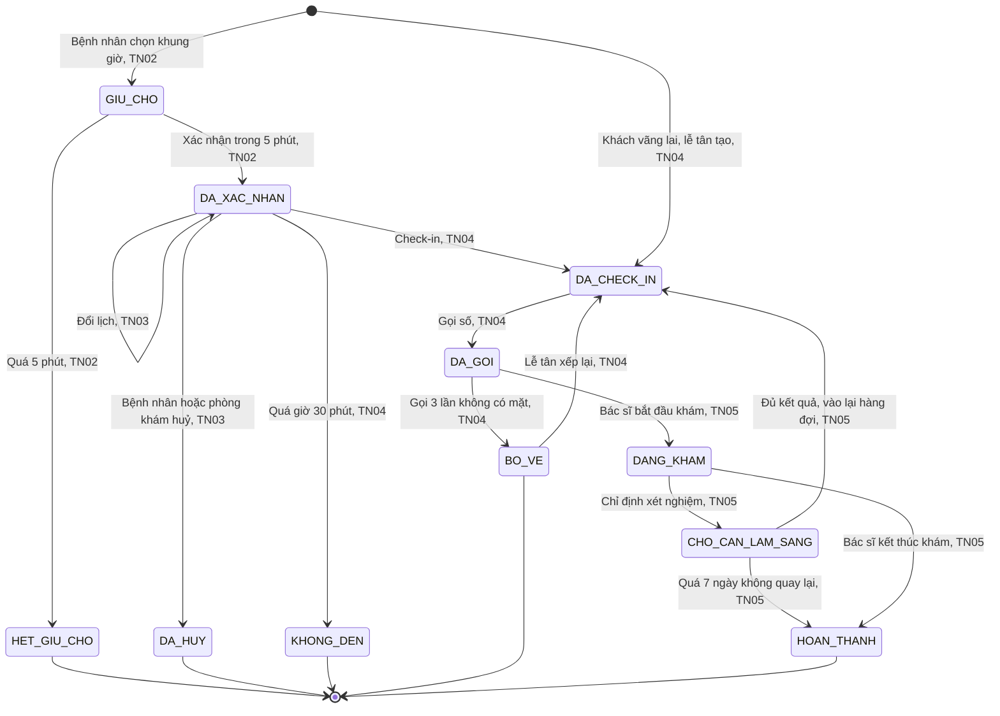
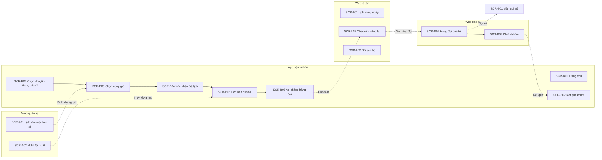

# Đề 7 · Đặt lịch khám phòng khám

> **Mã:** DE07 · **Độ khó:** 7/8 · **Vai trò:** 4 (bệnh nhân, lễ tân, bác sĩ, quản trị phòng khám) · **Nền tảng:** App bệnh nhân iOS / Android · Web lễ tân · Web bác sĩ (tablet) · Màn gọi số `[giả định]`

Phòng khám đa khoa tư nhân cho bệnh nhân đặt lịch theo chuyên khoa hoặc bác sĩ. Bệnh nhân giữ chỗ tạm khi chọn giờ, được nhắc lịch, check-in tại quầy hoặc bằng QR, lấy số thứ tự và theo dõi hàng đợi. Bác sĩ khám theo số và ghi nhận kết quả. Đây là đề có **bốn vai trò**, **tài nguyên hữu hạn bị tranh chấp** (khung giờ), **hàng đợi realtime** và **dữ liệu sức khoẻ nhạy cảm**. Đề gồm 5 tính năng; mỗi tính năng có 1 PRD và 1 SRS riêng.

## Tính năng

| **Mã** | **Tính năng** | **Phạm vi** | **PRD** | **SRS** |
| --- | --- | --- | --- | --- |
| TN01 | Lịch làm việc bác sĩ & khung giờ | Ca làm việc lặp lại, ngày nghỉ, sinh khung giờ, sức chứa, khoá khung, bác sĩ nghỉ đột xuất | [PRD](docs/TN01-lich-lam-viec-khung-gio/PRD.md) | [SRS](docs/TN01-lich-lam-viec-khung-gio/SRS.md) |
| TN02 | Bệnh nhân đặt lịch | Chọn chuyên khoa hoặc bác sĩ, ngày, giờ; giữ chỗ tạm; hồ sơ người khám; xác nhận | [PRD](docs/TN02-dat-lich/PRD.md) | [SRS](docs/TN02-dat-lich/SRS.md) |
| TN03 | Đổi / huỷ lịch | Bệnh nhân đổi, huỷ theo chính sách; lễ tân đổi hộ; phòng khám huỷ hàng loạt | [PRD](docs/TN03-doi-huy-lich/PRD.md) | [SRS](docs/TN03-doi-huy-lich/SRS.md) |
| TN04 | Nhắc lịch, check-in & số thứ tự | Nhắc trước 24 giờ, 2 giờ; check-in QR hoặc tại quầy; số thứ tự; hàng đợi realtime; khách vãng lai; không đến | [PRD](docs/TN04-nhac-lich-checkin-so-thu-tu/PRD.md) | [SRS](docs/TN04-nhac-lich-checkin-so-thu-tu/SRS.md) |
| TN05 | Khám & ghi nhận kết quả | Bác sĩ gọi số, xem tiền sử, ghi chẩn đoán, chỉ định, đơn thuốc, hẹn tái khám; bệnh nhân xem kết quả | [PRD](docs/TN05-kham-ghi-nhan-ket-qua/PRD.md) | [SRS](docs/TN05-kham-ghi-nhan-ket-qua/SRS.md) |

Thứ tự làm gợi ý: TN01 → TN02 → TN03 → TN04 → TN05.

## Vòng đời lịch hẹn (dùng chung cả đề)



## Kiến trúc màn hình



## Bối cảnh chung

Bệnh nhân thường phải gọi tổng đài hoặc đến sớm xếp hàng lấy số, chờ hàng giờ mà không biết bao giờ tới lượt. Lễ tân giờ cao điểm vừa nghe điện thoại, vừa check-in, vừa xử lý khách vãng lai. Bác sĩ thiếu thông tin tiền sử khi gọi bệnh nhân vào. Thiết kế phải cân bằng: **bệnh nhân chủ động**, **lễ tân kiểm soát được ngoại lệ**, **bác sĩ tập trung vào khám**, và **dữ liệu sức khoẻ được bảo vệ**.

| **Nhóm người dùng** | **Nhu cầu chính** |
| --- | --- |
| Bệnh nhân đi làm | Đặt lịch ngoài giờ hành chính, biết chính xác khi nào tới lượt |
| Người đặt hộ (con đặt cho bố mẹ, bố mẹ đặt cho con) | Quản lý nhiều người khám trong một tài khoản |
| Người lớn tuổi | Check-in tại quầy, không bắt buộc dùng app |
| Lễ tân | Xem lịch trong ngày, check-in nhanh, chen khách vãng lai, đổi lịch hộ |
| Bác sĩ | Hàng đợi rõ ràng, tiền sử ngay khi gọi số, ghi kết quả nhanh |
| Quản trị phòng khám | Lịch làm việc bác sĩ, xử lý bác sĩ nghỉ đột xuất |

Ngoài phạm vi cả đề: thanh toán viện phí và đặt cọc online, bảo hiểm y tế, khám từ xa (video), nhà thuốc và giao thuốc, kết nối máy xét nghiệm (nhập kết quả thủ công), nhiều cơ sở, hồ sơ bệnh án điện tử đầy đủ theo chuẩn.

## Quy ước dùng chung

- Màn App bệnh nhân mã `SCR-B..`, Web lễ tân `SCR-L..`, Web bác sĩ `SCR-D..`, Web quản trị `SCR-A..`, Màn gọi số `SCR-T..`.
- "Người khám" là hồ sơ của người được khám, khác với tài khoản đặt lịch: một tài khoản có tối đa 5 người khám (bản thân và người thân).
- Đăng nhập bệnh nhân bằng số điện thoại và OTP; nhân viên bằng tài khoản và mật khẩu, có xác thực hai lớp.
- Mã BR, MSG, UC đánh số liên tục trong cả đề: TN01 dùng BR-01–12, MSG-01–08; TN02 dùng BR-13–26, MSG-09–20; TN03 dùng BR-27–38, MSG-21–30; TN04 dùng BR-39–54, MSG-31–44; TN05 dùng BR-55–68, MSG-45–54. Mã bổ sung sau đánh tiếp từ số cuối: BR-69 (chống đặt ảo), BR-70 (đặt cho nhiều người khám), MSG-55, MSG-56 ở SRS TN02; BR-71 (tải PDF kết quả) ở SRS TN05.
- Giá trị đánh dấu `[giả định]` dùng để dựng flow, cần PO hoặc BA xác nhận trước khi dùng. Nội dung y khoa trong tài liệu chỉ để minh hoạ luồng.

## Danh sách màn hình

| **Mã** | **Màn hình** | **Nền tảng** | **Mô tả chi tiết ở** |
| --- | --- | --- | --- |
| SCR-A01 | Lịch làm việc bác sĩ | Web quản trị | SRS TN01 |
| SCR-A02 | Nghỉ đột xuất | Web quản trị | SRS TN01, TN03 |
| SCR-B01 | Trang chủ | App bệnh nhân | SRS TN02 |
| SCR-B02 | Chọn chuyên khoa, bác sĩ | App bệnh nhân | SRS TN02 |
| SCR-B03 | Chọn ngày giờ | App bệnh nhân | SRS TN02 |
| SCR-B04 | Xác nhận đặt lịch | App bệnh nhân | SRS TN02 |
| SCR-B05 | Lịch hẹn của tôi | App bệnh nhân | SRS TN03 |
| SCR-B06 | Vé khám, hàng đợi | App bệnh nhân | SRS TN02 (phần xác nhận), SRS TN04 (hàng đợi) |
| SCR-B07 | Kết quả khám | App bệnh nhân | SRS TN05 |
| SCR-L01 | Lịch trong ngày | Web lễ tân | SRS TN04 |
| SCR-L02 | Check-in, vãng lai | Web lễ tân | SRS TN04 |
| SCR-L03 | Đổi lịch hộ | Web lễ tân | SRS TN03 |
| SCR-D01 | Hàng đợi của tôi | Web bác sĩ | SRS TN05 |
| SCR-D02 | Phiên khám | Web bác sĩ | SRS TN05 |
| SCR-T01 | Màn gọi số | TV phòng chờ | SRS TN04 |

## Cấu trúc repo

```text
de07-dat-lich-kham-phong-kham/
├── README.md
└── docs/
    ├── TN01-lich-lam-viec-khung-gio/        PRD.md · SRS.md
    ├── TN02-dat-lich/                       PRD.md · SRS.md
    ├── TN03-doi-huy-lich/                   PRD.md · SRS.md
    ├── TN04-nhac-lich-checkin-so-thu-tu/    PRD.md · SRS.md
    └── TN05-kham-ghi-nhan-ket-qua/          PRD.md · SRS.md
```

## Cách dùng bộ tài liệu

1. Đọc README để nắm vòng đời lịch hẹn và bốn vai trò.
2. Với mỗi tính năng: đọc PRD, rồi SRS. Với mỗi trạng thái, thiết kế màn của **mọi vai trò** thấy trạng thái đó.
3. Chú ý ngoại lệ: khung giờ bị người khác giữ, bác sĩ nghỉ đột xuất, bệnh nhân đến trễ, khách vãng lai.
4. Thiết kế màn hình theo đúng mã SCR, mã MSG trong SRS để dễ đối chiếu khi review.
5. Sơ đồ viết bằng Mermaid, xem trực tiếp trên GitHub hoặc trình xem Markdown có hỗ trợ Mermaid.
