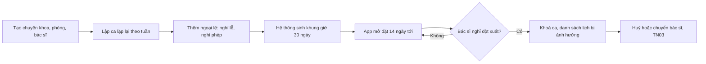

> **Mã:** DE07-TN01-PRD · **Trạng thái:** nháp · **Người viết:** Design (mock) · **SRS:** [SRS.md](SRS.md)

# PRD Lịch làm việc bác sĩ và khung giờ (Đặt lịch khám phòng khám)

> **Bản mock.** Con số đánh dấu `[giả định]` dùng để dựng flow, cần PO xác nhận trước khi dùng.

## 1. Bối cảnh và vấn đề

### 1.1 Bối cảnh

Bệnh nhân chỉ đặt được những khung giờ mà phòng khám mở ([TN02](../TN02-dat-lich/PRD.md)). Khung giờ sinh ra từ lịch làm việc của từng bác sĩ: ca nào, phòng nào, mỗi lượt khám bao lâu, nhận bao nhiêu người. Lịch thay đổi thường xuyên: bác sĩ đi hội thảo, nghỉ ốm, phòng khám nghỉ lễ. Tính năng này lo phần cung: tạo và giữ lịch làm việc chính xác.

### 1.2 Vấn đề

| **Vấn đề** | **Hệ quả** |
| --- | --- |
| Lịch bác sĩ ghi trên bảng tính, cập nhật chậm | Bệnh nhân đặt vào giờ bác sĩ không làm |
| Mỗi tuần nhập lại lịch | Tốn công, dễ sai |
| Không giữ chỗ cho khách vãng lai, tái khám | Lễ tân không chen được người cần khám gấp |
| Bác sĩ nghỉ đột xuất, không biết ai đã đặt | Bệnh nhân đến mới biết, phàn nàn |
| Đổi thời lượng lượt khám làm lệch lịch đã đặt | Chồng chéo lịch |

### 1.3 Mục tiêu

- Thiết lập lịch làm việc lặp lại cho một bác sĩ trong ≤ 5 phút `[giả định]`.
- 100% lịch hẹn bị ảnh hưởng khi bác sĩ nghỉ đột xuất được xử lý trước giờ khám.
- Khung giờ trên App luôn khớp lịch làm việc, độ trễ ≤ 1 phút sau khi sửa `[giả định]`.

## 2. Người dùng

| **Nhóm** | **Nhu cầu với tính năng này** |
| --- | --- |
| Quản trị phòng khám | Lập lịch theo tuần lặp lại, ngày nghỉ, xử lý nghỉ đột xuất |
| Bác sĩ | Xem lịch của mình; đề nghị nghỉ |
| Lễ tân | Biết bác sĩ nào làm hôm nay, khung nào còn chỗ cho vãng lai |

## 3. Phạm vi

### 3.1 Trong phạm vi (MVP)

- Chuyên khoa, phòng khám, bác sĩ thuộc chuyên khoa.
- Ca làm việc lặp lại theo tuần: thứ, giờ bắt đầu, giờ kết thúc, phòng, thời lượng lượt khám, số người mỗi khung.
- Ngoại lệ: ngày nghỉ của phòng khám, ngày nghỉ của bác sĩ, ca bổ sung.
- Sinh khung giờ cho 30 ngày tới; mở đặt trước N ngày.
- Tỉ lệ dành cho đặt online và giữ cho vãng lai.
- Khoá, mở từng khung giờ.
- Nghỉ đột xuất: khoá ca, xem lịch hẹn bị ảnh hưởng, chuyển sang huỷ hàng loạt (TN03).

### 3.2 Ngoài phạm vi

- Bác sĩ tự đổi ca với nhau.
- Tối ưu lịch tự động theo nhu cầu.
- Lịch thiết bị (máy siêu âm, phòng mổ).
- Chấm công bác sĩ.

## 4. Nguyên tắc sản phẩm

### 4.1 Lập một lần, chạy mỗi tuần

Lịch lặp lại theo tuần, ngoại lệ chỉ ghi chỗ khác biệt.

### 4.2 Lịch đã đặt là cam kết

Sửa lịch làm việc không bao giờ âm thầm làm mất lịch hẹn đã có. Mọi thay đổi ảnh hưởng tới bệnh nhân đều hiện rõ số người bị ảnh hưởng trước khi lưu.

### 4.3 Chừa chỗ cho ngoại lệ

Mỗi khung giữ lại một phần cho khách vãng lai và ca cần khám gấp.

### 4.4 Thông tin đúng ở mọi nơi

Lịch đổi trên Web quản trị là App bệnh nhân và Web lễ tân thấy ngay.

## 5. Quy tắc nghiệp vụ

| **Quy tắc** | **Giá trị** `[giả định]` |
| --- | --- |
| Thời lượng lượt khám | 10, 15, 20, 30 phút |
| Số người mỗi khung | 1–6 |
| Dành cho online | 70% sức chứa mỗi khung; 30% giữ cho lễ tân |
| Mở đặt trước | 14 ngày |
| Đóng đặt | 2 giờ trước giờ khung |
| Sinh khung | Hằng ngày, cho 30 ngày tới |
| Sửa ca có lịch đã đặt | Không xoá khung có lịch; chỉ khoá, phải xử lý lịch trước |
| Nghỉ đột xuất | Khoá mọi khung của ca; lịch hẹn vào danh sách cần xử lý |

- Các giá trị trên là **cấu hình theo phòng khám**, không cố định trong code.

## 6. Luồng trải nghiệm

| **Bước** | **Giai đoạn** | **Trải nghiệm** | **Đầu ra** |
| --- | --- | --- | --- |
| 1 | Danh mục | Chuyên khoa, phòng, hồ sơ bác sĩ | Dữ liệu nền |
| 2 | Ca lặp lại | Lịch tuần dạng lưới: kéo chọn giờ, chọn phòng, thời lượng, sức chứa | Ca làm việc |
| 3 | Ngoại lệ | Ngày nghỉ phòng khám, nghỉ phép bác sĩ, ca bổ sung | Lịch thực tế |
| 4 | Xem khung | Lưới khung giờ theo ngày: đã đặt, còn trống, giữ cho vãng lai, khoá | Kiểm tra |
| 5 | Nghỉ đột xuất | Chọn bác sĩ, ngày, ca → số lịch bị ảnh hưởng → xác nhận | Khung khoá, lịch cần xử lý |

## 7. Use Cases, User Stories và Acceptance Criteria

### UC1. Lập lịch làm việc

#### US1.1 Tạo ca lặp lại

User Story: Là quản trị phòng khám, tôi muốn lập lịch tuần cho bác sĩ một lần để khung giờ tự sinh mỗi tuần.

AC01: Ca gồm: bác sĩ, thứ trong tuần, giờ bắt đầu, kết thúc, phòng, thời lượng lượt, số người mỗi khung, ngày hiệu lực.

AC02: Không cho hai ca của một bác sĩ chồng giờ; không cho hai bác sĩ cùng phòng cùng giờ.

AC03: Xem trước số khung sẽ sinh mỗi tuần.

AC04: Khung giờ có trên App trong ≤ 1 phút sau khi lưu.

#### US1.2 Ngoại lệ

User Story: Là quản trị phòng khám, tôi muốn ghi ngày nghỉ, ca bổ sung để lịch đúng thực tế.

AC01: Ngày nghỉ của phòng khám áp dụng cho mọi bác sĩ.

AC02: Nghỉ phép bác sĩ theo ngày hoặc theo ca.

AC03: Ca bổ sung một lần (ví dụ thứ Bảy đặc biệt).

AC04: Ngoại lệ trùng ngày đã có lịch hẹn → hiện số lịch bị ảnh hưởng, chuyển sang luồng xử lý (UC3).

### UC2. Quản lý khung giờ

#### US2.1 Xem và khoá khung

User Story: Là quản trị phòng khám, tôi muốn xem và khoá khung giờ còn trống để xử lý việc riêng của phòng khám.

AC01: Lưới khung theo ngày, bác sĩ: tổng sức chứa, đã đặt online, đã đặt tại quầy, còn trống, giữ cho vãng lai.

AC02: Khoá một khung còn trống → không ai đặt được; mở lại được.

AC03: Khung đã có lịch không khoá được, phải xử lý lịch trước.

#### US2.2 Tỉ lệ online và vãng lai

User Story: Là quản trị phòng khám, tôi muốn giữ một phần chỗ cho lễ tân để còn chỗ cho khách vãng lai và ca gấp.

AC01: Phần dành cho online hiện trên App; phần giữ chỉ lễ tân đặt được.

AC02: Trước giờ khung 2 giờ, phần giữ còn trống mở cho lễ tân dùng tự do.

### UC3. Bác sĩ nghỉ đột xuất

User Story: Là quản trị, tôi muốn khoá lịch của bác sĩ nghỉ đột xuất và biết ngay ai bị ảnh hưởng.

AC01: Chọn bác sĩ, ngày, ca; hiện danh sách lịch hẹn bị ảnh hưởng.

AC02: Xác nhận → khoá mọi khung của ca; App không cho đặt thêm.

AC03: Danh sách lịch bị ảnh hưởng chuyển sang xử lý: huỷ kèm thông báo, hoặc chuyển sang bác sĩ khác cùng chuyên khoa (TN03).

AC04: Lễ tân thấy cảnh báo trên lịch trong ngày.

## 8. Chỉ số theo dõi `[giả định]`

| **Chỉ số** | **Định nghĩa** | **Mục tiêu MVP** |
| --- | --- | --- |
| Tỉ lệ lấp đầy | Khung đã đặt / tổng sức chứa đã mở | Theo dõi theo chuyên khoa |
| Độ trễ đồng bộ | Từ lưu lịch tới App hiện khung | ≤ 1 phút |
| Lịch hẹn bị huỷ do phòng khám | Lịch huỷ vì nghỉ đột xuất / tổng lịch | ≤ 2% |
| Thời gian xử lý nghỉ đột xuất | Từ khoá ca tới mọi lịch được xử lý | ≤ 2 giờ |
| Tỉ lệ dùng phần giữ cho vãng lai | Chỗ giữ được lễ tân dùng / chỗ giữ | Theo dõi để chỉnh tỉ lệ 70/30 |

## 9. Phụ thuộc và rủi ro

| **Mục** | **Mô tả** | **Hướng xử lý** |
| --- | --- | --- |
| Sửa lịch làm mất lịch hẹn | Bệnh nhân đến không có bác sĩ | Không xoá khung có lịch; bắt xử lý trước |
| Đổi thời lượng lượt khám | Lệch khung đã đặt | Chỉ áp dụng cho ngày chưa có lịch hẹn |
| Nghỉ đột xuất sát giờ | Bệnh nhân đã trên đường | Thông báo nhiều kênh (SMS, push); lễ tân gọi điện |
| Sinh khung lỗi | App trống lịch | Giám sát số khung mỗi ngày; cảnh báo khi bằng 0 |

## 10. Câu hỏi mở

- Tỉ lệ 70/30 cố định hay theo chuyên khoa?
- Mở đặt trước 14 ngày có phù hợp cho chuyên khoa đông như nhi?
- Bác sĩ có tự đăng ký nghỉ trên Web không, hay chỉ quản trị?
- Có cho đặt lịch khám ngay trong ngày qua App không?
