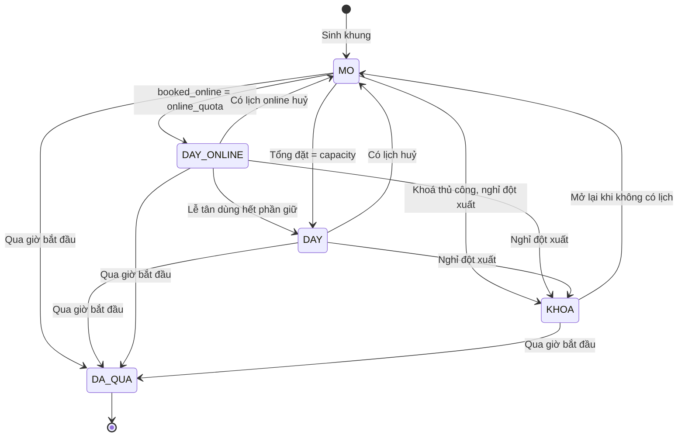
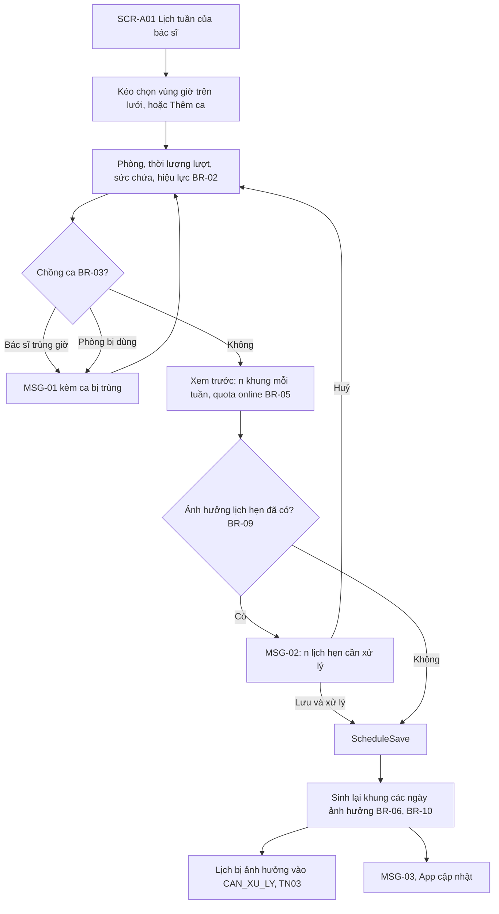
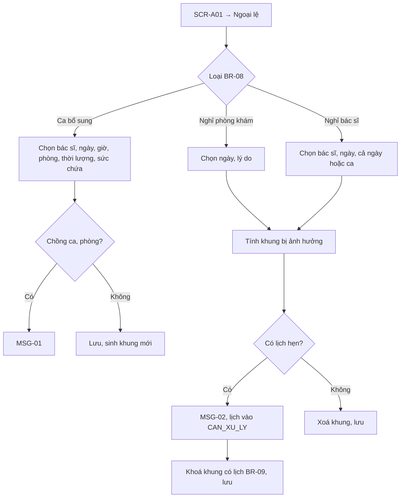
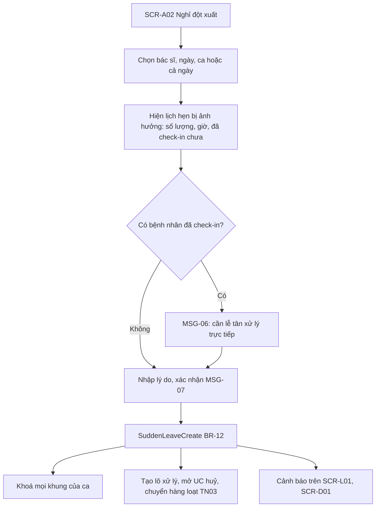
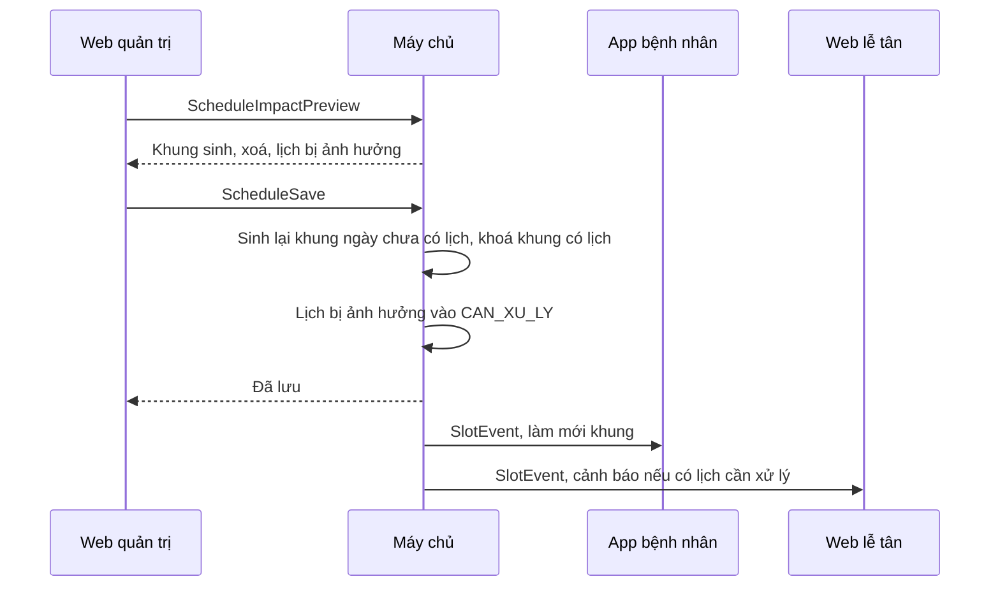

> **Mã:** DE07-TN01-SRS · **Trạng thái:** nháp · **Người viết:** Design (mock) · **PRD:** [PRD.md](PRD.md)

# UC-DE07-01 - Lịch làm việc bác sĩ và khung giờ

> **Bản mock.** Giá trị `[giả định]` cần BA xác nhận. Đặt lịch dùng khung giờ xem [SRS TN02](../TN02-dat-lich/SRS.md); xử lý lịch hẹn bị ảnh hưởng xem [SRS TN03](../TN03-doi-huy-lich/SRS.md).

## 1. Tổng quan

| **Mục** | **Nội dung** |
| --- | --- |
| Mục tiêu | Quản trị lập lịch làm việc lặp lại, ngoại lệ, khoá khung; hệ thống sinh khung giờ có sức chứa; xử lý bác sĩ nghỉ đột xuất |
| Actor | Quản trị phòng khám · Bác sĩ (xem) · Lễ tân (xem) · Web quản trị · Máy chủ · Tác vụ sinh khung |
| Phạm vi | Chuyên khoa, phòng, bác sĩ, ca lặp lại, ngoại lệ, sinh khung, sức chứa online và giữ chỗ, khoá khung, nghỉ đột xuất |
| Ngoài phạm vi | Đổi ca giữa bác sĩ, tối ưu lịch tự động, lịch thiết bị, chấm công |
| Nền tảng | Web quản trị (desktop) `[giả định]` |
| Figma | `[chưa có]` |

## 2. User Story

| **ID** | **As a** | **I want** | **So that** |
| --- | --- | --- | --- |
| US-01 | Quản trị | Lập ca lặp lại theo tuần | Khung giờ tự sinh |
| US-02 | Quản trị | Ghi ngày nghỉ, ca bổ sung | Lịch đúng thực tế |
| US-03 | Quản trị | Giữ một phần chỗ cho lễ tân | Còn chỗ cho vãng lai, ca gấp |
| US-04 | Quản trị | Khoá khung còn trống | Xử lý việc riêng của phòng khám |
| US-05 | Quản trị | Xử lý bác sĩ nghỉ đột xuất | Bệnh nhân được báo kịp |

## 3. Business Rules

| **Mã** | **Quy tắc** |
| --- | --- |
| BR-01 | **Bác sĩ** thuộc 1–2 chuyên khoa; có hồ sơ công khai (tên, học hàm, chuyên khoa, ảnh, giới thiệu) và trạng thái `DANG_LAM` / `NGUNG` |
| BR-02 | **Ca lặp lại**: bác sĩ, thứ (T2–CN), giờ bắt đầu, giờ kết thúc (cách nhau ≥ thời lượng lượt), phòng, thời lượng lượt (10, 15, 20, 30 phút), sức chứa mỗi khung (1–6), hiệu lực từ ngày, đến ngày (tuỳ chọn) |
| BR-03 | **Chống chồng**: một bác sĩ không có 2 ca giao nhau; một phòng không có 2 ca giao nhau trong cùng ngày |
| BR-04 | **Khung giờ** = chia ca theo thời lượng lượt; khung cuối phải kết thúc ≤ giờ kết thúc ca. Mỗi khung: `start_at`, `end_at`, `capacity`, `online_quota`, `booked_online`, `booked_desk`, `status` |
| BR-05 | **Quota online** = làm tròn xuống (capacity × 70%), tối thiểu 1 khi capacity ≥ 1; phần còn lại (**quota quầy** = capacity − online_quota) giữ cho lễ tân, đếm ở `booked_desk`. Trước mốc 2 giờ, lễ tân chỉ đặt vào quota quầy để không lấn chỗ của App. Từ 2 giờ trước `start_at`, khi App đã đóng đặt (BR-07), phần quota online còn trống được mở cho lễ tân dùng như chỗ thường `[giả định]` |
| BR-06 | **Sinh khung**: tác vụ chạy 01:00 hằng ngày, sinh khung cho ngày thứ 30 kể từ hôm nay; sửa ca hoặc ngoại lệ → sinh lại ngay các ngày bị ảnh hưởng chưa có lịch hẹn |
| BR-07 | **Mở đặt** trên App: khung có `start_at` trong 14 ngày tới và ≥ 2 giờ kể từ hiện tại `[giả định]` |
| BR-08 | **Ngoại lệ**: `NGHI_PHONG_KHAM` (cả ngày, mọi bác sĩ), `NGHI_BAC_SI` (ngày hoặc ca), `CA_BO_SUNG` (một ngày, giờ, phòng). Ngoại lệ thắng ca lặp lại |
| BR-09 | **Sửa có lịch hẹn**: mọi thay đổi (sửa ca, ngoại lệ nghỉ) làm biến mất hoặc thu nhỏ khung đã có lịch hẹn → không xoá khung đó; khung chuyển `KHOA`, lịch hẹn vào danh sách `CAN_XU_LY` (TN03). Trước khi lưu hiện MSG-02 với số lịch bị ảnh hưởng |
| BR-10 | **Đổi thời lượng lượt, sức chứa** chỉ áp dụng cho ngày chưa có lịch hẹn nào trong ca đó; ngày đã có lịch giữ cấu hình cũ |
| BR-11 | **Khoá khung thủ công**: chỉ khung không có lịch hẹn; khung `KHOA` không đặt được ở mọi kênh; mở lại được |
| BR-12 | **Nghỉ đột xuất**: chọn bác sĩ, ngày, ca → tạo ngoại lệ `NGHI_BAC_SI`, khoá mọi khung, tạo lô xử lý với danh sách lịch hẹn; báo lễ tân bằng cảnh báo trên **SCR-L01** |

## 4. Trạng thái

### 4.1 Trạng thái khung giờ

| **Trạng thái** | **App bệnh nhân** | **Web lễ tân** |
| --- | --- | --- |
| `MO` | Hiện, đặt được nếu còn quota online | Đặt được vào quota quầy; từ 2 giờ trước giờ khung dùng được cả quota online còn trống (BR-05) |
| `DAY_ONLINE` | Hiện "Hết chỗ" | Đặt được phần giữ |
| `DAY` | Hiện "Hết chỗ" | Hết chỗ; vẫn thêm được vãng lai vượt (TN04) |
| `KHOA` | Không hiện | Hiện khoá kèm lý do |
| `DA_QUA` | Không hiện | Chỉ xem |

## 5. Use Case

### UC-01 Lập ca lặp lại

| **Mục** | **Nội dung** |
| --- | --- |
| Tiền điều kiện | Quản trị đăng nhập; có chuyên khoa, phòng, bác sĩ |
| Hậu điều kiện thành công | Ca được lưu; khung sinh cho 30 ngày; App cập nhật ≤ 1 phút |
| Hậu điều kiện thất bại | Ca không lưu |

**Luồng chính**

| **Bước** | **Actor** | **Mô tả** |
| --- | --- | --- |
| 1 | Quản trị | Mở **SCR-A01**, chọn bác sĩ |
| 2 | Quản trị | Kéo chọn vùng giờ trên lưới tuần hoặc bấm "Thêm ca" |
| 3 | Quản trị | Chọn phòng, thời lượng lượt, sức chứa, hiệu lực |
| 4 | Web | Kiểm tra BR-03; hiện xem trước số khung |
| 5 | Quản trị | Bấm Lưu |
| 6 | Máy chủ | Lưu (\[ScheduleSave\]); sinh khung (BR-06); đẩy cập nhật |

**Luồng thay thế**

| **Mã** | **Điều kiện** | **Xử lý** |
| --- | --- | --- |
| A1 | Sửa ca ảnh hưởng lịch hẹn | MSG-02 trước khi lưu (BR-09) |
| A2 | Đổi thời lượng, sức chứa | Chỉ áp dụng ngày chưa có lịch (BR-10); MSG-04 nêu ngày bắt đầu áp dụng |
| A3 | Kết thúc ca (đặt ngày đến) | Khung sau ngày đó không sinh; khung có lịch theo A1 |
| A4 | Sao chép lịch tuần sang bác sĩ khác | Mở form với các ca đã điền, kiểm tra chồng phòng |

### UC-02 Thêm ngoại lệ

| **Mục** | **Nội dung** |
| --- | --- |
| Tiền điều kiện | Quản trị phòng khám đã đăng nhập; bác sĩ đã có lịch làm việc |
| Hậu điều kiện | Ngoại lệ được lưu; khung trống được gỡ hoặc thêm; khung đã có lịch chuyển `KHOA`, lịch hẹn vào danh sách `CAN_XU_LY` (BR-09) |

**Luồng chính**

| **Bước** | **Actor** | **Mô tả** |
| --- | --- | --- |
| 1 | Quản trị | **SCR-A01** → Ngoại lệ, chọn loại (BR-08): Nghỉ bác sĩ |
| 2 | Quản trị | Chọn bác sĩ, ngày, cả ngày hoặc ca; nhập lý do |
| 3 | Hệ thống | Tính các khung bị ảnh hưởng |
| 4 | Hệ thống | Không có lịch hẹn → xoá khung, lưu ngoại lệ |

**Luồng thay thế**

| **Mã** | **Điều kiện** | **Xử lý** |
| --- | --- | --- |
| A1 | Loại Nghỉ phòng khám | Chọn ngày, lý do; áp dụng cho mọi bác sĩ, xử lý như bước 3–4 |
| A2 | Loại Ca bổ sung | Chọn bác sĩ, ngày, giờ, phòng, thời lượng, sức chứa → lưu, sinh khung mới |
| A3 | Khung bị ảnh hưởng đã có lịch hẹn | MSG-02; khoá các khung có lịch (BR-09), lịch hẹn vào `CAN_XU_LY`, rồi lưu |

**Luồng lỗi**

| **Mã** | **Điều kiện** | **Xử lý** |
| --- | --- | --- |
| E1 | Ca bổ sung chồng ca hoặc phòng | MSG-01, không lưu |

### UC-03 Khoá, mở khung

| **Mục** | **Nội dung** |
| --- | --- |
| Tiền điều kiện | Khoá: khung `MO` chưa có lịch hẹn. Mở: khung `KHOA` không có lịch hẹn |
| Hậu điều kiện | Khung `KHOA` không ai đặt được, hoặc về `MO` |

**Luồng chính**

| **Bước** | **Actor** | **Mô tả** |
| --- | --- | --- |
| 1 | Quản trị | Ở lưới khung theo ngày, chọn một hoặc nhiều khung |
| 2 | Web | Khung có lịch hẹn → không chọn được, tooltip MSG-05 |
| 3 | Quản trị | Bấm Khoá, nhập lý do |
| 4 | Máy chủ | Khung `KHOA` (BR-11); App ẩn khung ≤ 1 phút |

### UC-04 Bác sĩ nghỉ đột xuất

| **Mục** | **Nội dung** |
| --- | --- |
| Tiền điều kiện | Bác sĩ có ca trong ngày được chọn |
| Hậu điều kiện | Khung của ca `KHOA`; lô xử lý gồm mọi lịch hẹn bị ảnh hưởng; lễ tân được cảnh báo |

**Luồng chính**

| **Bước** | **Actor** | **Mô tả** |
| --- | --- | --- |
| 1 | Quản trị | Mở **SCR-A02** Nghỉ đột xuất |
| 2 | Quản trị | Chọn bác sĩ, ngày, ca hoặc cả ngày |
| 3 | Hệ thống | Hiện lịch hẹn bị ảnh hưởng: số lượng, giờ, đã check-in hay chưa |
| 4 | Quản trị | Nhập lý do, xác nhận ở MSG-07 |
| 5 | Hệ thống | Gọi \[SuddenLeaveCreate\] (BR-12): khoá mọi khung của ca |
| 6 | Hệ thống | Tạo lô xử lý cho lễ tân huỷ, chuyển hàng loạt (SRS TN03) |
| 7 | Hệ thống | Hiện cảnh báo trên **SCR-L01**, **SCR-D01** |

**Luồng thay thế**

| **Mã** | **Điều kiện** | **Xử lý** |
| --- | --- | --- |
| A1 | Có bệnh nhân đã check-in | MSG-06: lễ tân cần báo trực tiếp cho những người này; vẫn cho xác nhận tiếp. Lịch `DA_CHECK_IN` chưa được gọi cũng vào lô xử lý, lễ tân chuyển bác sĩ hoặc đổi, huỷ hộ theo SRS TN03 (BR-34, BR-35) |

**Luồng lỗi**

| **Mã** | **Điều kiện** | **Xử lý** |
| --- | --- | --- |
| E1 | Tạo nghỉ đột xuất thất bại | Báo lỗi, không khoá khung nào, cho thử lại |

## 6. Điểm vào

| **Điểm vào** | **Dẫn tới** | **Ghi chú** |
| --- | --- | --- |
| Web quản trị → Lịch làm việc | **SCR-A01** | |
| Web quản trị → Nghỉ đột xuất | UC-04, **SCR-A02** | |
| Bác sĩ báo nghỉ (ngoài hệ thống) | Quản trị thực hiện UC-04 | `[giả định]` |
| Cảnh báo "Ngày {d} chưa có khung" | **SCR-A01** | Giám sát BR-06 |

## 7. Mô tả màn hình

### SCR-A01 Lịch làm việc bác sĩ

| **#** | **Thành phần** | **Loại** | **Hành vi** |
| --- | --- | --- | --- |
| 1 | Bộ lọc | Toolbar | Chuyên khoa, bác sĩ, phòng; chế độ Tuần mẫu · Theo ngày |
| 2 | Lưới tuần mẫu | Calendar grid | Cột thứ, hàng giờ; ca là khối màu theo phòng: "{phòng} · {phút}/lượt · {n} người"; kéo để tạo, kéo cạnh để đổi giờ |
| 3 | Form ca | Drawer | BR-02; xem trước số khung |
| 4 | Ngoại lệ | List | Theo tháng: loại, ngày, bác sĩ, lý do, số lịch bị ảnh hưởng |
| 5 | Lưới theo ngày | Grid | Khung giờ × bác sĩ: "{đặt}/{sức chứa}", online, quầy, giữ, trạng thái; chọn để khoá |
| 6 | Trạng thái đồng bộ | Text phụ | "Đã cập nhật lên App lúc {giờ}" |

### SCR-A02 Nghỉ đột xuất

| **#** | **Thành phần** | **Loại** | **Bắt buộc** | **Hành vi** |
| --- | --- | --- | --- | --- |
| 1 | Bác sĩ | Select | Có | |
| 2 | Ngày, ca | Date + chọn ca | Có | Cả ngày hoặc từng ca |
| 3 | Lịch bị ảnh hưởng | Table | – | Giờ, bệnh nhân (tên viết tắt), kênh đặt, trạng thái |
| 4 | Lý do | Text | Có | Hiện cho lễ tân; lý do gửi bệnh nhân chọn ở TN03 |
| 5 | Xác nhận khoá lịch | Button đỏ | – | MSG-07 |

## 8. API

| **API** | **Request chính** | **Response chính** | **Timeout / retry** `[giả định]` |
| --- | --- | --- | --- |
| \[ScheduleGet\] | doctor_id hoặc department_id, range | Ca, ngoại lệ, khung | 5s / 1 lần |
| \[ScheduleSave\] | Ca (thêm, sửa, kết thúc) | Kết quả, impacted_appointments | 8s / 2 lần |
| \[ScheduleImpactPreview\] | Thay đổi dự kiến | Số khung sinh, xoá; lịch hẹn bị ảnh hưởng | 5s / 1 lần |
| \[ExceptionSave\] | type, doctor_id, date, shift, reason | Kết quả, impacted_appointments | 8s / 2 lần |
| \[SlotLock\] | slot_ids, locked, reason | Kết quả từng khung | 5s / 2 lần |
| \[SuddenLeaveCreate\] | doctor_id, date, shift_ids, reason | batch_id, affected | 8s / 2 lần |
| \[SlotGenerateJob\] | – | Sinh khung BR-06 | Chạy 01:00 hằng ngày |
| \[SlotEvent\] (máy chủ → App, Web) | Thay đổi khung | – | Kết nối realtime hoặc làm mới cache ≤ 1 phút |

**Map lỗi → thông báo**

| **Nhóm lỗi** | **Message** |
| --- | --- |
| Ca trùng với ca khác của bác sĩ hoặc phòng | MSG-01 |
| Thay đổi ảnh hưởng lịch hẹn đã đặt | MSG-02 |
| Khoá khung đã có lịch hẹn | MSG-05 |
| Nghỉ đột xuất khi đã có bệnh nhân check-in | MSG-06 |
| Lưu lịch thất bại | Thông báo lỗi chung của app (ngoài bộ MSG của SRS này), cho thử lại; giữ nội dung đang sửa |

## 9. Danh sách thông báo

| **ID** | **Nơi hiện** | **Nội dung (VI)** |
| --- | --- | --- |
| MSG-01 | Inline | Trùng với ca {thứ, giờ} của {bác sĩ / phòng} |
| MSG-02 | Popup | Thay đổi này ảnh hưởng {n} lịch hẹn đã đặt. Các lịch này sẽ chuyển sang danh sách cần xử lý. \[Huỷ\] \[Lưu và xử lý\] |
| MSG-03 | Toast | Đã lưu lịch. Khung giờ trên App sẽ cập nhật trong 1 phút |
| MSG-04 | Inline | Thay đổi thời lượng, sức chứa áp dụng từ {ngày} vì các ngày trước đã có lịch hẹn |
| MSG-05 | Tooltip | Khung đã có lịch hẹn, không khoá được |
| MSG-06 | Banner | Có {n} bệnh nhân đã check-in. Lễ tân cần thông báo trực tiếp |
| MSG-07 | Popup | Khoá toàn bộ lịch của {bác sĩ} ngày {d}? {n} lịch hẹn sẽ cần huỷ hoặc chuyển. \[Huỷ\] \[Khoá lịch\] |
| MSG-08 | Banner Web lễ tân, bác sĩ | {Bác sĩ} nghỉ {ca} hôm nay: {lý do}. {n} lịch hẹn đang được xử lý |

Bản EN: `[chờ bổ sung]`.

## 10. Yêu cầu phi chức năng

| **Mục** | **Yêu cầu** `[giả định]` |
| --- | --- |
| Hiệu năng | Lưu ca, sinh lại khung 30 ngày ≤ 5 giây; App thấy khung mới ≤ 1 phút |
| Toàn vẹn | Không có thao tác nào xoá khung có lịch hẹn; sinh khung idempotent theo (ca, ngày) |
| Thời gian | Mọi giờ theo múi giờ phòng khám (Asia/Ho_Chi_Minh) |
| Audit | Ghi nhật ký sửa ca, ngoại lệ, khoá khung, nghỉ đột xuất: ai, lúc nào, trước, sau |
| Giám sát | Cảnh báo khi một ngày trong 14 ngày tới có 0 khung cho chuyên khoa đang hoạt động |
| Bảo mật | Chỉ quản trị phòng khám sửa lịch làm việc, ngoại lệ, khoá khung; mọi thao tác yêu cầu đăng nhập và phân quyền theo vai trò |
| Accessibility | Lưới dùng được bằng bàn phím; trạng thái khung có chữ, không chỉ màu |
