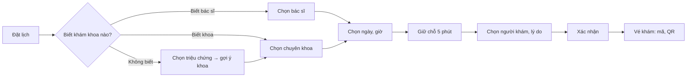

> **Mã:** DE07-TN02-PRD · **Trạng thái:** đã chốt · **Người viết:** Design · **SRS:** [SRS.md](SRS.md)

# PRD Bệnh nhân đặt lịch (Đặt lịch khám phòng khám)

## 1. Bối cảnh và vấn đề

### 1.1 Bối cảnh

Khung giờ đã được mở từ lịch làm việc bác sĩ ([TN01](../TN01-lich-lam-viec-khung-gio/PRD.md)). Bệnh nhân giờ tự đặt trên App thay vì gọi tổng đài. Khó khăn chính: nhiều người cùng nhìn một khung giờ cuối cùng, bệnh nhân không biết nên khám chuyên khoa nào, và người đặt thường không phải người đi khám.

### 1.2 Vấn đề

| **Vấn đề** | **Hệ quả** |
| --- | --- |
| Hai người cùng chọn một chỗ cuối, cả hai tưởng đã đặt | Một người đến không có lịch |
| Không biết khám chuyên khoa nào | Đặt sai, phải chuyển khoa, mất lượt |
| Đặt cho bố mẹ, con nhưng hồ sơ là của mình | Bác sĩ nhận sai thông tin bệnh nhân |
| Đặt xong không có gì để đối chiếu | Đến quầy không chứng minh được đã đặt |
| Đặt giữ chỗ nhiều lịch rồi không đến | Mất chỗ của người khác |

### 1.3 Mục tiêu

- Đặt lịch trong ≤ 2 phút với người khám đã có hồ sơ.
- 0 trường hợp hai lịch hẹn chiếm cùng một chỗ.
- ≥ 50% lịch hẹn của phòng khám đặt qua App trong 3 tháng.

## 2. Người dùng

| **Nhóm** | **Nhu cầu với tính năng này** |
| --- | --- |
| Bệnh nhân đi làm | Đặt nhanh ngoài giờ, chọn giờ sớm nhất |
| Người đặt hộ | Thêm hồ sơ người thân, đặt cho đúng người |
| Bệnh nhân tái khám | Đặt lại đúng bác sĩ đã khám |
| Bệnh nhân không biết khám khoa nào | Gợi ý chuyên khoa theo triệu chứng |

## 3. Phạm vi

### 3.1 Trong phạm vi (MVP)

- Đặt theo chuyên khoa (bác sĩ bất kỳ, giờ sớm nhất) hoặc theo bác sĩ cụ thể.
- Gợi ý chuyên khoa từ danh sách triệu chứng phổ biến.
- Chọn ngày, chọn khung giờ còn chỗ.
- Giữ chỗ tạm 5 phút khi chọn khung giờ.
- Hồ sơ người khám: tối đa 5 người trong một tài khoản.
- Lý do khám, triệu chứng ngắn; ảnh đính kèm tuỳ chọn.
- Xác nhận: mã lịch hẹn, QR check-in, thêm vào lịch điện thoại.
- Giới hạn số lịch hẹn đang chờ mỗi người khám.

### 3.2 Ngoài phạm vi

- Đặt cọc, thanh toán online.
- Bảo hiểm y tế, bảo hiểm tư nhân.
- Tư vấn triệu chứng bằng AI.
- Đặt lịch xét nghiệm, chẩn đoán hình ảnh riêng lẻ → phase sau.

## 4. Nguyên tắc sản phẩm

### 4.1 Chỗ đã chọn là của mình trong 5 phút

Khi chọn khung giờ, chỗ được giữ riêng, có đồng hồ đếm ngược. Không ai khác lấy được trong lúc bệnh nhân điền thông tin.

### 4.2 Người khám luôn rõ ràng

Mỗi lịch hẹn gắn với một người khám cụ thể, chọn ở bước đầu xác nhận. Tên người khám hiện to trên vé.

### 4.3 Không biết khám gì cũng đặt được

Chọn theo triệu chứng hoặc chọn "Khám tổng quát", không bắt bệnh nhân tự đoán chuyên khoa.

### 4.4 Công bằng về chỗ

Giới hạn số lịch đang chờ mỗi người để không ai giữ nhiều chỗ.

## 5. Quy tắc nghiệp vụ

| **Quy tắc** | **Giá trị** |
| --- | --- |
| Giữ chỗ tạm | 5 phút; mỗi tài khoản giữ tối đa 1 chỗ cùng lúc |
| Người khám mỗi tài khoản | Tối đa 5 |
| Lịch đang chờ | Tối đa 2 lịch mỗi người khám; không 2 lịch cùng chuyên khoa cùng ngày |
| Thông tin người khám | Họ tên, ngày sinh, giới tính, số điện thoại liên hệ; CCCD tuỳ chọn |
| Lý do khám | Bắt buộc, ≤ 300 ký tự; ảnh tối đa 3, ≤ 5 MB |
| Mở đặt | 14 ngày tới, đóng trước 2 giờ (TN01) |
| Trẻ em | Người khám dưới 16 tuổi phải có người giám hộ là chủ tài khoản |

- Các giá trị trên là **cấu hình theo phòng khám**, không cố định trong code.

## 6. Luồng trải nghiệm

| **Bước** | **Giai đoạn** | **Trải nghiệm** | **Đầu ra** |
| --- | --- | --- | --- |
| 1 | Bắt đầu | Trang chủ: Đặt lịch khám, Tái khám với bác sĩ cũ | Chọn cách đặt |
| 2 | Chọn khoa, bác sĩ | Danh sách chuyên khoa, bác sĩ; gợi ý theo triệu chứng | Khoa hoặc bác sĩ |
| 3 | Chọn giờ | Dải ngày 14 ngày, khung giờ theo buổi; "Sớm nhất" nổi bật | Khung giờ |
| 4 | Giữ chỗ | Đồng hồ 5 phút hiện suốt các bước sau | Chỗ được giữ |
| 5 | Thông tin | Chọn người khám (hoặc thêm mới), lý do khám | Hồ sơ đặt |
| 6 | Xác nhận | Tóm tắt, quy định đổi, huỷ; bấm Xác nhận | Lịch hẹn |
| 7 | Vé khám | Mã lịch hẹn, QR check-in, hướng dẫn tới phòng khám | Sẵn sàng đi khám |

## 7. Use Cases, User Stories và Acceptance Criteria

### UC1. Chọn chuyên khoa hoặc bác sĩ

#### US1.1 Chọn theo chuyên khoa hoặc triệu chứng

User Story: Là bệnh nhân, tôi muốn được gợi ý khám khoa nào khi tôi chỉ biết mình bị gì.

AC01: Danh sách chuyên khoa có tên, mô tả ngắn, ngày khám sớm nhất còn chỗ.

AC02: "Chưa biết khám khoa nào?" → chọn 1–3 triệu chứng phổ biến → gợi ý 1–2 chuyên khoa kèm lý do.

AC03: Luôn có lựa chọn "Khám tổng quát".

#### US1.2 Chọn theo bác sĩ

User Story: Là bệnh nhân, tôi muốn chọn đúng bác sĩ mình muốn khám để được theo dõi liên tục.

AC01: Hồ sơ bác sĩ: ảnh, học hàm, chuyên khoa, giới thiệu, lịch làm việc trong tuần.

AC02: "Tái khám" hiện bác sĩ người khám đã gặp trong 6 tháng qua.

### UC2. Chọn ngày giờ và giữ chỗ

#### US2.1 Chọn khung giờ

User Story: Là bệnh nhân, tôi muốn thấy khung giờ sớm nhất còn chỗ để được khám sớm.

AC01: Dải 14 ngày; ngày không có chỗ mờ đi; có nút "Ngày sớm nhất còn chỗ".

AC02: Khung giờ chia Sáng, Chiều, Tối; mỗi khung ghi giờ và còn bao nhiêu chỗ khi ≤ 2.

AC03: Đặt theo chuyên khoa → mỗi khung ghi tên bác sĩ, hoặc chọn "Bác sĩ bất kỳ".

#### US2.2 Giữ chỗ

User Story: Là bệnh nhân, tôi muốn chỗ mình chọn không bị người khác lấy mất khi tôi đang điền thông tin.

AC01: Chọn khung → giữ chỗ 5 phút; đồng hồ đếm ngược hiện ở mọi bước sau.

AC02: Khung vừa hết chỗ khi bấm → báo ngay, gợi ý khung gần nhất.

AC03: Hết 5 phút → báo hết thời gian giữ, quay về chọn giờ, giữ nguyên dữ liệu đã điền.

AC04: Đổi khung khác → thả chỗ cũ, giữ chỗ mới.

### UC3. Thông tin và xác nhận

#### US3.1 Chọn người khám

User Story: Là người đặt hộ, tôi muốn chọn đúng người khám để bác sĩ nhận đúng thông tin.

AC01: Danh sách người khám trong tài khoản; thêm người mới ngay tại bước này.

AC02: Người khám đã có 2 lịch đang chờ, hoặc đã có lịch cùng khoa cùng ngày → báo, không cho tiếp.

AC03: Người khám dưới 16 tuổi → ghi chú cần người giám hộ đi cùng.

#### US3.2 Lý do khám và xác nhận

User Story: Là bệnh nhân, tôi muốn ghi lý do khám và nhận vé khám có mã, QR để check-in nhanh.

AC01: Lý do khám bắt buộc, có gợi ý theo triệu chứng đã chọn; đính kèm ảnh tuỳ chọn.

AC02: Màn xác nhận: người khám, bác sĩ, chuyên khoa, ngày giờ, địa chỉ, phòng, quy định đổi và huỷ.

AC03: Xác nhận thành công → vé khám với mã lịch hẹn, QR, thêm vào lịch, chỉ đường.

AC04: Gửi SMS xác nhận tới số liên hệ của người khám.

## 8. Chỉ số theo dõi

| **Chỉ số** | **Định nghĩa** | **Mục tiêu MVP** |
| --- | --- | --- |
| Tỉ lệ hoàn tất | Lịch xác nhận / lượt giữ chỗ | ≥ 75% |
| Thời gian đặt | Từ bắt đầu tới xác nhận | ≤ 2 phút (trung vị) |
| Tỉ lệ hết giữ chỗ | Giữ chỗ hết hạn / lượt giữ chỗ | ≤ 15% |
| Tỉ lệ va chạm | Lượt chọn khung vừa hết chỗ / lượt chọn | Theo dõi |
| Tỉ lệ dùng gợi ý chuyên khoa | Đặt qua triệu chứng / tổng đặt | Theo dõi |
| Tỉ lệ chuyển khoa tại phòng khám | Lịch phải chuyển khoa khi khám / tổng lịch | ≤ 5% |

## 9. Phụ thuộc và rủi ro

| **Mục** | **Mô tả** | **Hướng xử lý** |
| --- | --- | --- |
| Tranh chấp chỗ cuối | Hai người cùng xác nhận | Giữ chỗ tạm có khoá ở máy chủ |
| Gợi ý chuyên khoa sai | Bệnh nhân khám sai khoa | Bảng triệu chứng do bác sĩ duyệt; luôn có Khám tổng quát |
| Dữ liệu sức khoẻ | Lý do khám, ảnh là dữ liệu nhạy cảm | Mã hoá; chỉ nhân viên liên quan xem |
| Giữ chỗ ảo | Người dùng giữ rồi bỏ | Giới hạn 1 chỗ giữ mỗi tài khoản, 5 phút |

## 10. Câu hỏi mở

> Mọi câu hỏi dưới đây đã được PO chốt ngày 13/11/2026; quyết định ghi sau mỗi câu và đã cập nhật vào SRS.

- Có cần CCCD để chống đặt ảo không? → **Đã chốt:** Không. CCCD tuỳ chọn; chống đặt ảo dùng bộ đếm không đến (SRS BR-69).
- Bác sĩ bất kỳ có ưu tiên bác sĩ ít lịch hơn không? → **Đã chốt:** Có. Chọn bác sĩ ít lịch nhất trong buổi (SRS BR-15).
- Có cho đặt cùng lúc nhiều người khám (gia đình) trong một lượt? → **Đã chốt:** Có, tối đa 3 người trong một lượt (SRS BR-70).
- Thời gian giữ chỗ 5 phút có đủ khi phải thêm người khám mới? → **Đã chốt:** Giữ 5 phút; đặt cho nhiều người thì cộng 2 phút mỗi người (SRS BR-70).
