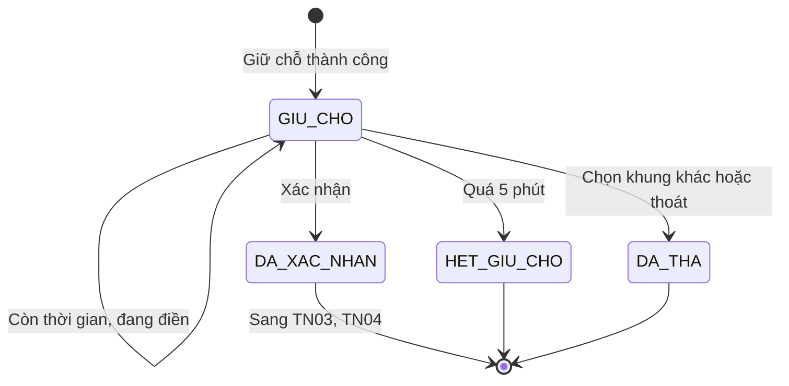
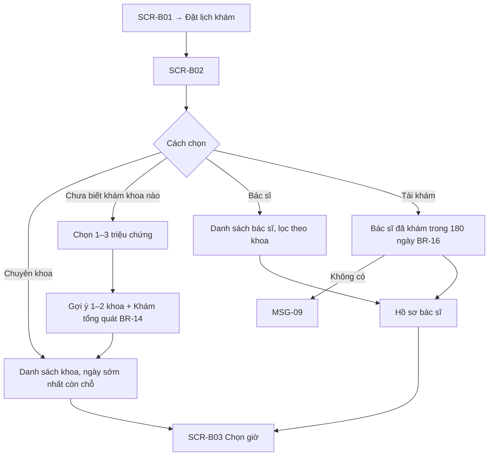
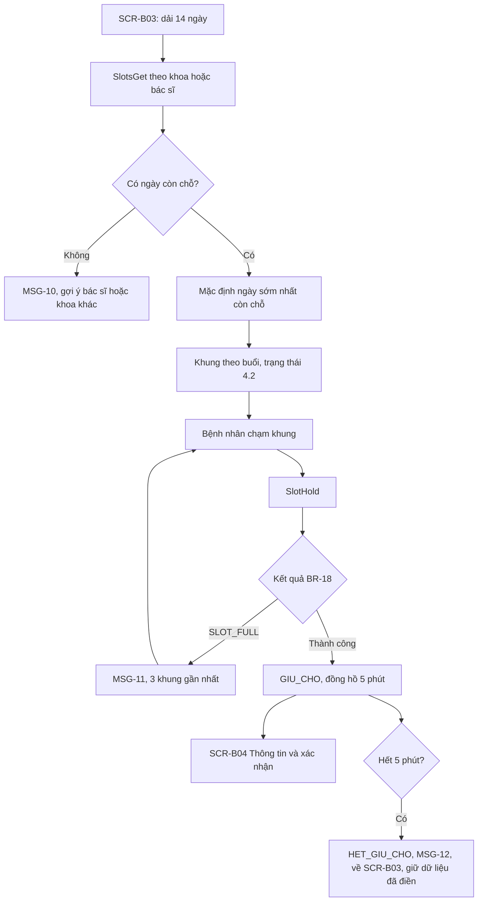
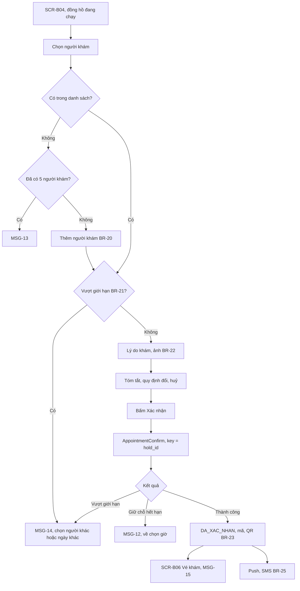
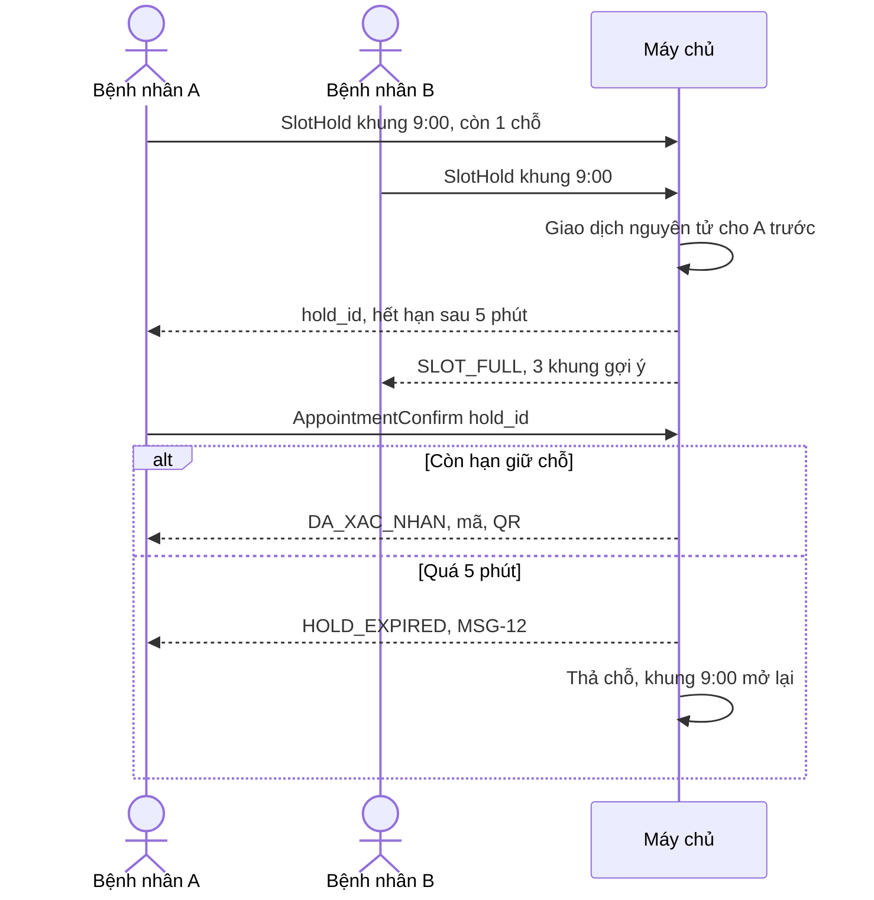

> **Mã:** DE07-TN02-SRS · **Trạng thái:** nháp · **Người viết:** Design (mock) · **PRD:** [PRD.md](PRD.md)

# UC-DE07-02 - Bệnh nhân đặt lịch

> **Bản mock.** Giá trị `[giả định]` cần BA xác nhận. Khung giờ xem [SRS TN01](../TN01-lich-lam-viec-khung-gio/SRS.md); đổi, huỷ xem [SRS TN03](../TN03-doi-huy-lich/SRS.md); check-in xem [SRS TN04](../TN04-nhac-lich-checkin-so-thu-tu/SRS.md).

## 1. Tổng quan

| **Mục** | **Nội dung** |
| --- | --- |
| Mục tiêu | Bệnh nhân chọn chuyên khoa hoặc bác sĩ, chọn khung giờ, giữ chỗ tạm, chọn người khám, nhập lý do và xác nhận lịch hẹn |
| Actor | Người đặt (chủ tài khoản) · Người khám · App bệnh nhân · Máy chủ · Dịch vụ SMS |
| Phạm vi | Chuyên khoa, gợi ý theo triệu chứng, bác sĩ, tái khám, chọn khung, giữ chỗ, hồ sơ người khám, lý do khám, xác nhận, vé khám |
| Ngoài phạm vi | Đặt cọc, bảo hiểm, tư vấn AI, đặt xét nghiệm riêng |
| Nền tảng | App bệnh nhân iOS / Android `[giả định]` |
| Figma | `[chưa có]` |

## 2. User Story

| **ID** | **As a** | **I want** | **So that** |
| --- | --- | --- | --- |
| US-06 | Bệnh nhân | Được gợi ý chuyên khoa theo triệu chứng | Khám đúng khoa |
| US-07 | Bệnh nhân | Thấy giờ sớm nhất còn chỗ | Khám sớm |
| US-08 | Bệnh nhân | Chỗ đã chọn được giữ trong lúc điền thông tin | Không bị người khác lấy |
| US-09 | Người đặt hộ | Chọn đúng người khám | Bác sĩ nhận đúng thông tin |
| US-10 | Bệnh nhân | Có vé khám với mã và QR | Check-in nhanh |

## 3. Business Rules

| **Mã** | **Quy tắc** |
| --- | --- |
| BR-13 | **Khung đặt được trên App**: trạng thái `MO`, `booked_online < online_quota`, trong cửa sổ mở đặt (BR-07) |
| BR-14 | **Gợi ý chuyên khoa**: bảng ánh xạ triệu chứng → chuyên khoa do quản trị phòng khám cấu hình (bác sĩ duyệt); chọn 1–3 triệu chứng, trả về 1–2 khoa theo số triệu chứng khớp; luôn kèm "Khám tổng quát" |
| BR-15 | **Bác sĩ bất kỳ**: khung giờ gộp theo giờ trong một chuyên khoa; khi giữ chỗ, chọn bác sĩ có ít lịch đã đặt nhất trong buổi đó `[giả định]` |
| BR-16 | **Tái khám**: hiện bác sĩ có lịch `HOAN_THANH` với người khám trong 180 ngày; bác sĩ `NGUNG` không hiện |
| BR-17 | **Giữ chỗ tạm** (`GIU_CHO`): tăng `booked_online` của khung ngay, hết hạn 5 phút; mỗi tài khoản tối đa 1 giữ chỗ còn hiệu lực, giữ chỗ mới thả giữ chỗ cũ |
| BR-18 | **Tranh chấp**: thao tác giữ chỗ là nguyên tử ở máy chủ (kiểm tra và tăng trong cùng một giao dịch); khung hết chỗ → trả lỗi `SLOT_FULL`, App gợi ý 3 khung gần nhất cùng khoa hoặc bác sĩ |
| BR-19 | **Hết giữ chỗ**: tác vụ mỗi 30 giây thả giữ chỗ quá hạn (giảm `booked_online`); App nhận sự kiện, hiện MSG-12 |
| BR-20 | **Người khám**: họ tên (2–50 ký tự), ngày sinh, giới tính, số điện thoại liên hệ (bắt buộc với người ≥ 16 tuổi; trẻ dưới 16 dùng số chủ tài khoản), quan hệ với chủ tài khoản, CCCD tuỳ chọn. Tối đa 5 người khám mỗi tài khoản |
| BR-21 | **Giới hạn lịch**: mỗi người khám tối đa 2 lịch `DA_XAC_NHAN` chưa diễn ra; không 2 lịch cùng chuyên khoa cùng ngày |
| BR-22 | **Lý do khám** bắt buộc 10–300 ký tự; tối đa 3 ảnh JPG, PNG ≤ 5 MB mỗi ảnh |
| BR-23 | **Xác nhận**: kiểm tra giữ chỗ còn hiệu lực, BR-21; chuyển `GIU_CHO` → `DA_XAC_NHAN`; sinh mã lịch hẹn 8 ký tự và QR check-in (mã ký số, hết hạn sau ngày khám) |
| BR-24 | **Idempotency**: xác nhận dùng hold_id làm khoá; bấm nhiều lần chỉ tạo 1 lịch hẹn |
| BR-25 | **Thông báo xác nhận**: push cho chủ tài khoản; SMS cho số liên hệ của người khám (nếu khác số chủ tài khoản thì gửi cả hai) |
| BR-26 | **Trẻ em**: người khám dưới 16 tuổi → vé khám ghi "Cần người giám hộ đi cùng" |

## 4. Trạng thái

### 4.1 Trạng thái lịch hẹn trong phạm vi SRS này

### 4.2 Trạng thái khung giờ trên SCR-B03

| **Trạng thái** | **Điều kiện** | **Hiển thị** |
| --- | --- | --- |
| `CON_CHO` | Còn quota online > 2 | Nút giờ bình thường |
| `SAP_HET` | Còn 1–2 chỗ online | Nút giờ + "Còn {n} chỗ" |
| `HET_CHO` | Hết quota online | Mờ, gạch, chữ "Hết" |
| `DANG_GIU` | Tài khoản này đang giữ | Viền đậm, đồng hồ |

## 5. Use Case

### UC-05 Chọn chuyên khoa, bác sĩ

### UC-06 Chọn khung giờ và giữ chỗ

| **Mục** | **Nội dung** |
| --- | --- |
| Tiền điều kiện | Đã chọn chuyên khoa hoặc bác sĩ; bệnh nhân đăng nhập |
| Hậu điều kiện thành công | Lịch `GIU_CHO` 5 phút |
| Hậu điều kiện thất bại | Không giữ chỗ; gợi ý khung khác |

**Luồng chính**

| **Bước** | **Actor** | **Mô tả** |
| --- | --- | --- |
| 1 | App | Tải khung 14 ngày (\[SlotsGet\]); chọn sẵn ngày sớm nhất còn chỗ |
| 2 | Bệnh nhân | Chọn ngày, chạm khung giờ |
| 3 | App | Gọi \[SlotHold\] |
| 4 | Máy chủ | Kiểm tra, tăng `booked_online` nguyên tử (BR-17, BR-18); trả hold_id, hết hạn |
| 5 | App | Mở **SCR-B04** với đồng hồ đếm ngược |

**Luồng thay thế**

| **Mã** | **Điều kiện** | **Xử lý** |
| --- | --- | --- |
| A1 | Khung vừa hết chỗ | MSG-11 với 3 khung gợi ý |
| A2 | Đặt theo khoa, chọn "Bác sĩ bất kỳ" | Máy chủ chọn bác sĩ theo BR-15; **SCR-B04** hiện tên bác sĩ đã chọn |
| A3 | Đang giữ chỗ khác | Giữ chỗ mới thả chỗ cũ (BR-17) |
| A4 | Quay lại chọn khung khác | Thả giữ chỗ, giữ khung mới |

### UC-07 Chọn người khám và xác nhận

| **Mục** | **Nội dung** |
| --- | --- |
| Tiền điều kiện | Lịch `GIU_CHO` còn hiệu lực |
| Hậu điều kiện thành công | Lịch `DA_XAC_NHAN`; vé khám; SMS, push |
| Hậu điều kiện thất bại | Lịch `GIU_CHO` hoặc `HET_GIU_CHO` |

**Luồng chính**

| **Bước** | **Actor** | **Mô tả** |
| --- | --- | --- |
| 1 | Người đặt | Chọn người khám trong danh sách |
| 2 | App | Kiểm tra BR-21 |
| 3 | Người đặt | Nhập lý do khám; đính kèm ảnh (tuỳ chọn) |
| 4 | Người đặt | Xem tóm tắt, bấm "Xác nhận đặt lịch" |
| 5 | Máy chủ | \[AppointmentConfirm\] theo BR-23, BR-24 |
| 6 | App | Mở **SCR-B06** với vé khám; gửi thông báo (BR-25) |

**Luồng thay thế**

| **Mã** | **Điều kiện** | **Xử lý** |
| --- | --- | --- |
| A1 | Thêm người khám mới | Form ngắn BR-20; lưu xong chọn luôn |
| A2 | Người khám dưới 16 tuổi | Ghi chú giám hộ (BR-26) |
| A3 | Còn ≤ 60 giây giữ chỗ | Đồng hồ chuyển màu cảnh báo, kèm chữ "Sắp hết thời gian" |

**Luồng lỗi**

| **Mã** | **Điều kiện** | **Xử lý** |
| --- | --- | --- |
| E1 | Giữ chỗ hết hạn khi bấm | MSG-12; dữ liệu đã điền được giữ để đặt lại |
| E2 | Lỗi mạng | Gửi lại cùng hold_id; vẫn lỗi → MSG-16 |
| E3 | Ảnh quá lớn | MSG-17 |

## 6. Điểm vào

| **Điểm vào** | **Dẫn tới** | **Ghi chú** |
| --- | --- | --- |
| SCR-B01 → Đặt lịch khám | UC-05 | |
| SCR-B01 → Tái khám | UC-05 (tái khám) | |
| Hẹn tái khám từ kết quả khám | **SCR-B03** của đúng bác sĩ | SRS TN05 |
| Link chia sẻ hồ sơ bác sĩ | Hồ sơ bác sĩ → **SCR-B03** | |
| Đổi lịch (TN03) | **SCR-B03** chế độ đổi | SRS TN03 |

## 7. Mô tả màn hình

### SCR-B01 Trang chủ

| **#** | **Thành phần** | **Loại** | **Hành vi** |
| --- | --- | --- | --- |
| 1 | Lời chào, người khám đang chọn | Header | Đổi người khám trong tài khoản (tối đa 5) |
| 2 | Đặt lịch khám | Button chính | Mở **SCR-B02** (UC-05) |
| 3 | Lịch hẹn sắp tới | Card | Lịch gần nhất: bác sĩ, ngày giờ, trạng thái; chạm → **SCR-B06**. Không có lịch → ẩn card |
| 4 | Tái khám | Card | Chỉ hiện khi có lời hẹn tái khám chưa đặt (TN05, BR-64); chạm → UC-05 với bác sĩ và ngày gợi ý điền sẵn |
| 5 | Kết quả khám gần đây | Dòng liên kết | Mở **SCR-B07** (TN05), cần xác thực lại |
| 6 | Màn trống | Empty state | Tài khoản chưa có lịch nào: hình minh hoạ, nút "Đặt lịch khám" `[giả định]` |

### SCR-B02 Chọn chuyên khoa, bác sĩ

| **#** | **Thành phần** | **Loại** | **Hành vi** |
| --- | --- | --- | --- |
| 1 | Tab | Tabs | Chuyên khoa · Bác sĩ |
| 2 | Thẻ chuyên khoa | List | Tên, mô tả ngắn, "Sớm nhất: {thứ, dd/mm}" |
| 3 | "Chưa biết khám khoa nào?" | Card | Mở chọn triệu chứng (chips, tối đa 3) → kết quả gợi ý BR-14 |
| 4 | Thẻ bác sĩ | List | Ảnh, tên, học hàm, chuyên khoa, "Sớm nhất: …" |
| 5 | Hồ sơ bác sĩ | Màn | Giới thiệu, lịch làm việc tuần, nút "Đặt lịch với bác sĩ" |

### SCR-B03 Chọn ngày giờ

| **#** | **Thành phần** | **Loại** | **Hành vi** |
| --- | --- | --- | --- |
| 1 | Đầu màn | Header | Chuyên khoa hoặc bác sĩ đã chọn |
| 2 | Dải ngày | Horizontal list | 14 ngày; ngày hết chỗ mờ; "Sớm nhất" gắn nhãn |
| 3 | Bác sĩ | Select | Khi đặt theo khoa: Bác sĩ bất kỳ (mặc định) hoặc từng bác sĩ |
| 4 | Khung giờ | Grid theo buổi | Trạng thái 4.2; vùng chạm ≥ 44 pt |
| 5 | Không còn chỗ | Empty state | MSG-10 |

### SCR-B04 Xác nhận đặt lịch

| **#** | **Thành phần** | **Loại** | **Bắt buộc** | **Validate / hành vi** |
| --- | --- | --- | --- | --- |
| 1 | Đồng hồ giữ chỗ | Banner cố định | – | "Giữ chỗ còn {mm:ss}"; ≤ 60 giây đổi màu kèm chữ |
| 2 | Lịch đã chọn | Card | – | Bác sĩ, khoa, ngày giờ, phòng; "Đổi giờ" |
| 3 | Người khám | Chọn 1 + Thêm mới | Có | BR-20, BR-21 |
| 4 | Lý do khám | Text nhiều dòng | Có | BR-22; gợi ý từ triệu chứng |
| 5 | Ảnh | Upload | Không | ≤ 3 ảnh |
| 6 | Quy định | Text phụ | – | Đổi, huỷ trước 2 giờ (TN03); có mặt trước 15 phút |
| 7 | Xác nhận đặt lịch | Button | – | Disabled khi thiếu trường bắt buộc |

### SCR-B06 Vé khám (phần xác nhận)

| **#** | **Thành phần** | **Loại** | **Hành vi** |
| --- | --- | --- | --- |
| 1 | Người khám | Tiêu đề lớn | Họ tên, tuổi; nhãn giám hộ (BR-26) |
| 2 | Lịch | Card | Bác sĩ, khoa, ngày giờ, phòng, địa chỉ |
| 3 | Mã lịch hẹn, QR | Code | QR dùng check-in (SRS TN04) |
| 4 | Hành động | Buttons | Thêm vào lịch · Chỉ đường · Đổi lịch · Huỷ lịch (TN03) |

## 8. API

| **API** | **Request chính** | **Response chính** | **Timeout / retry** `[giả định]` |
| --- | --- | --- | --- |
| \[DepartmentList\] | – | Khoa, mô tả, earliest_date | 3s / 1 lần |
| \[SymptomSuggest\] | symptom_ids | 1–2 khoa, lý do | 3s / 1 lần |
| \[DoctorList\] | department_id, filter | Bác sĩ, earliest_date | 3s / 1 lần |
| \[SlotsGet\] | department_id hoặc doctor_id, date_range | Khung theo ngày, trạng thái, còn chỗ | 3s / 1 lần |
| \[SlotHold\] | slot_id hoặc (department_id, time), patient_account_id | hold_id, doctor_id, expires_at hoặc SLOT_FULL + gợi ý | 3s / không tự retry |
| \[HoldRelease\] | hold_id | – | 3s / 2 lần |
| \[PatientProfileSave\] | Thông tin người khám | patient_id | 5s / 2 lần |
| \[AppointmentConfirm\] | hold_id, patient_id, reason, attachments | appointment_id, code, qr | 5s / gửi lại cùng hold_id |
| \[HoldExpireJob\] | – | Thả giữ chỗ quá hạn BR-19 | Chạy mỗi 30 giây |

## 9. Danh sách thông báo

| **ID** | **Nơi hiện** | **Nội dung (VI)** |
| --- | --- | --- |
| MSG-09 | **SCR-B02** | Chưa có lần khám nào trong 6 tháng qua. Hãy chọn chuyên khoa hoặc bác sĩ |
| MSG-10 | **SCR-B03** | Hiện chưa còn chỗ trong 14 ngày tới. Thử bác sĩ khác hoặc gọi phòng khám {hotline} |
| MSG-11 | Popup | Khung giờ này vừa hết chỗ. Gợi ý cho bạn: {3 khung} |
| MSG-12 | Popup | Hết thời gian giữ chỗ. Vui lòng chọn lại giờ, thông tin bạn đã điền vẫn được giữ |
| MSG-13 | Inline | Mỗi tài khoản có tối đa 5 người khám |
| MSG-14 | Inline | {Người khám} đã có {2 lịch đang chờ / lịch {khoa} ngày này}. Vui lòng chọn ngày khác hoặc người khám khác |
| MSG-15 | Màn vé khám | Đặt lịch thành công! Vui lòng có mặt trước {giờ − 15 phút} |
| MSG-16 | Toast | Kết nối không ổn định, vui lòng thử lại |
| MSG-17 | Inline | Ảnh cần là JPG hoặc PNG, tối đa 5 MB |
| MSG-18 | SMS | {Phòng khám}: Lịch khám {người khám} với {bác sĩ} lúc {giờ, ngày}. Mã {code}. Có mặt trước 15 phút |
| MSG-19 | Banner **SCR-B04** | Sắp hết thời gian giữ chỗ |
| MSG-20 | Inline | Người khám dưới 16 tuổi cần người giám hộ đi cùng |

Bản EN: `[chờ bổ sung]`.

## 10. Yêu cầu phi chức năng

| **Mục** | **Yêu cầu** `[giả định]` |
| --- | --- |
| Hiệu năng | \[SlotsGet\] ≤ 1 giây; \[SlotHold\] ≤ 500 ms (p95) kể cả giờ cao điểm 7:00 sáng |
| Nhất quán | Không bao giờ vượt `online_quota`; giữ chỗ và xác nhận là thao tác nguyên tử |
| Bảo mật dữ liệu sức khoẻ | Lý do khám, ảnh mã hoá khi lưu và truyền; chỉ lễ tân, bác sĩ của lịch hẹn xem được; không đưa vào thông báo đẩy |
| QR | Ký số, không chứa thông tin cá nhân, chỉ chứa mã lịch hẹn và chữ ký |
| Tracking | Đường vào đặt lịch (khoa, triệu chứng, bác sĩ, tái khám), giữ chỗ, va chạm, hết giữ chỗ, xác nhận, thời gian đặt |
| Accessibility | Đồng hồ giữ chỗ được trình đọc màn hình thông báo khi còn 60 giây; trạng thái khung có chữ; hỗ trợ cỡ chữ lớn cho người lớn tuổi |
