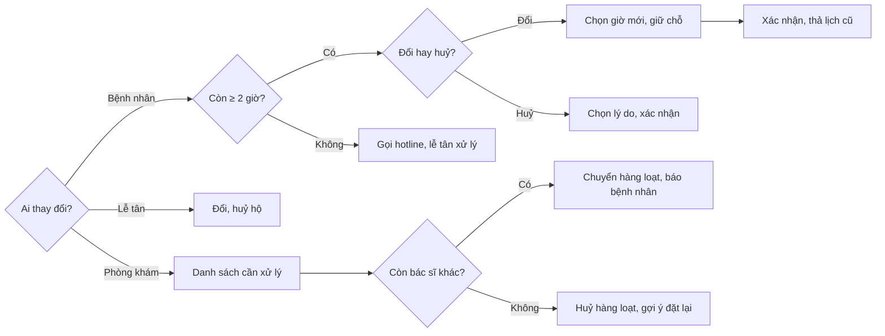

> **Mã:** DE07-TN03-PRD · **Trạng thái:** nháp · **Người viết:** Design (mock) · **SRS:** [SRS.md](SRS.md)

# PRD Đổi và huỷ lịch (Đặt lịch khám phòng khám)

> **Bản mock.** Con số đánh dấu `[giả định]` dùng để dựng flow, cần PO xác nhận trước khi dùng.

## 1. Bối cảnh và vấn đề

### 1.1 Bối cảnh

Lịch hẹn đã đặt ([TN02](../TN02-dat-lich/PRD.md)) thường thay đổi: bệnh nhân bận việc, con ốm thêm, bác sĩ nghỉ đột xuất ([TN01](../TN01-lich-lam-viec-khung-gio/PRD.md)). Nếu đổi, huỷ khó, bệnh nhân không đến mà không báo, chỗ bị bỏ trống. Tính năng này cho ba phía cùng xử lý thay đổi: bệnh nhân tự đổi, huỷ; lễ tân đổi hộ người gọi điện; phòng khám huỷ hoặc chuyển lịch hàng loạt.

### 1.2 Vấn đề

| **Vấn đề** | **Hệ quả** |
| --- | --- |
| Không đổi được lịch trên App | Bệnh nhân bỏ lịch, đặt lịch mới, chỗ cũ trống |
| Đổi lịch phải huỷ rồi đặt lại | Mất chỗ cũ khi chỗ mới chưa chắc có |
| Huỷ sát giờ không có quy định | Chỗ trống không kịp cho người khác |
| Phòng khám huỷ, gọi từng người | Lễ tân quá tải, bỏ sót người |
| Bệnh nhân lớn tuổi gọi điện đổi lịch | Lễ tân không có công cụ đổi hộ |

### 1.3 Mục tiêu

- ≥ 70% thay đổi lịch do bệnh nhân tự làm trên App `[giả định]`.
- Tỉ lệ không đến không báo ≤ 10% `[giả định]`.
- 100% bệnh nhân bị ảnh hưởng bởi phòng khám huỷ được báo ≥ 2 giờ trước giờ khám (khi có thể).

## 2. Người dùng

| **Nhóm** | **Nhu cầu với tính năng này** |
| --- | --- |
| Bệnh nhân | Đổi sang giờ khác mà không mất chỗ cũ trước khi có chỗ mới; huỷ dễ dàng |
| Lễ tân | Đổi, huỷ hộ người gọi điện; xử lý danh sách lịch bị ảnh hưởng |
| Quản trị | Chuyển hàng loạt sang bác sĩ khác hoặc huỷ kèm lời xin lỗi |

## 3. Phạm vi

### 3.1 Trong phạm vi (MVP)

- Bệnh nhân đổi ngày giờ, đổi bác sĩ cùng chuyên khoa; giữ lịch cũ tới khi lịch mới xác nhận.
- Bệnh nhân huỷ có lý do.
- Chính sách: đổi, huỷ trên App trước 2 giờ; tối đa 2 lần đổi mỗi lịch.
- Lễ tân đổi, huỷ hộ, có ghi người thao tác.
- Danh sách lịch cần xử lý (do sửa lịch, nghỉ đột xuất).
- Xử lý hàng loạt: chuyển sang bác sĩ khác cùng khung, hoặc huỷ kèm gợi ý đặt lại.
- Thông báo cho bệnh nhân qua push, SMS.

### 3.2 Ngoài phạm vi

- Phí huỷ, phạt không đến (không có thanh toán ở MVP).
- Danh sách chờ (waitlist) khi có chỗ trống → phase sau.
- Bệnh nhân chuyển lịch cho người khám khác.
- Đổi chuyên khoa (phải huỷ và đặt mới).

## 4. Nguyên tắc sản phẩm

### 4.1 Đổi an toàn

Lịch cũ chỉ được thả khi lịch mới đã xác nhận. Bệnh nhân không bao giờ mất cả hai.

### 4.2 Huỷ dễ, để chỗ về cho người khác

Huỷ chỉ vài chạm, không gây khó dễ. Chỗ được trả lại ngay cho người khác đặt.

### 4.3 Phòng khám sai thì phòng khám chủ động

Khi phòng khám huỷ, bệnh nhân được báo sớm, có lời xin lỗi, và gợi ý lịch mới sẵn sàng.

### 4.4 Mọi thay đổi có dấu vết

Ai đổi, ai huỷ, khi nào, vì sao đều được ghi lại và hiện trong lịch sử lịch hẹn.

## 5. Quy tắc nghiệp vụ

| **Quy tắc** | **Giá trị** `[giả định]` |
| --- | --- |
| Hạn tự đổi, huỷ trên App | Trước giờ khám ≥ 2 giờ |
| Sau hạn | Chỉ lễ tân đổi, huỷ được (bệnh nhân gọi hotline) |
| Số lần đổi | Tối đa 2 lần mỗi lịch hẹn |
| Phạm vi đổi | Cùng chuyên khoa; trong cửa sổ mở đặt 14 ngày |
| Lý do huỷ | Bắt buộc chọn: Bận việc, Đã khỏi, Đặt nhầm, Khám nơi khác, Khác |
| Chuyển hàng loạt | Chỉ sang bác sĩ cùng chuyên khoa, cùng khung, còn chỗ |
| Thông báo phòng khám huỷ | Push + SMS ngay; lễ tân gọi điện nếu < 4 giờ tới giờ khám |

- Các giá trị trên là **cấu hình theo phòng khám**, không cố định trong code.

## 6. Luồng trải nghiệm

| **Bước** | **Vai trò** | **Trải nghiệm** | **Đầu ra** |
| --- | --- | --- | --- |
| 1 | Bệnh nhân | Lịch hẹn của tôi → chọn lịch → Đổi lịch hoặc Huỷ lịch | Bắt đầu thay đổi |
| 2 | Bệnh nhân | Đổi: chọn giờ mới (giữ chỗ 5 phút), xác nhận | Lịch mới, lịch cũ thả |
| 3 | Bệnh nhân | Huỷ: chọn lý do, xác nhận | Lịch huỷ, chỗ trả lại |
| 4 | Lễ tân | Tìm lịch theo số điện thoại, mã; đổi, huỷ hộ | Lịch được xử lý |
| 5 | Lễ tân, quản trị | Danh sách cần xử lý: chuyển hoặc huỷ hàng loạt | Bệnh nhân được báo |

## 7. Use Cases, User Stories và Acceptance Criteria

### UC1. Bệnh nhân đổi lịch

#### US1.1 Đổi giờ mà không mất chỗ cũ

User Story: Là bệnh nhân, tôi muốn đổi sang giờ khác mà vẫn giữ lịch cũ nếu chưa có giờ mới phù hợp.

AC01: Nút Đổi lịch chỉ hiện khi còn ≥ 2 giờ và chưa đổi quá 2 lần; nếu không, hiện lý do và hotline.

AC02: Màn chọn giờ giống khi đặt, giới hạn cùng chuyên khoa; mặc định cùng bác sĩ.

AC03: Chọn giờ mới → giữ chỗ 5 phút; lịch cũ vẫn còn.

AC04: Xác nhận → lịch hẹn cập nhật giờ mới, chỗ cũ trả lại; mã lịch hẹn giữ nguyên, QR mới.

AC05: Thoát giữa chừng → lịch cũ giữ nguyên.

### UC2. Bệnh nhân huỷ lịch

AC01: Huỷ cần chọn lý do; hỏi xác nhận một lần.

AC02: Huỷ thành công → chỗ trả lại ngay; nhận thông báo xác nhận huỷ.

AC03: Sau hạn 2 giờ → không huỷ trên App; hiện hotline và nút "Báo không đến được" (ghi nhận, không phạt).

### UC3. Lễ tân đổi, huỷ hộ

AC01: Tìm lịch theo số điện thoại, tên, mã lịch hẹn.

AC02: Đổi, huỷ hộ được cả khi đã quá hạn 2 giờ.

AC03: Lịch sử lịch hẹn ghi "Lễ tân {tên} đổi theo yêu cầu qua điện thoại".

AC04: Bệnh nhân nhận thông báo như khi tự thay đổi.

### UC4. Phòng khám xử lý hàng loạt

#### US4.1 Xử lý lịch bị ảnh hưởng

User Story: Là lễ tân, tôi muốn xử lý nhanh mọi lịch bị ảnh hưởng khi bác sĩ nghỉ để không bỏ sót ai.

AC01: Danh sách cần xử lý nhóm theo lô (lý do, bác sĩ, ngày); mỗi dòng có giờ, bệnh nhân, số điện thoại, trạng thái thông báo.

AC02: Chuyển hàng loạt: chọn bác sĩ thay thế cùng khoa; hệ thống tự ghép vào cùng khung còn chỗ; lịch không ghép được tách riêng.

AC03: Huỷ hàng loạt: chọn lời nhắn mẫu xin lỗi; bệnh nhân nhận nút đặt lại với gợi ý giờ gần nhất.

AC04: Lịch < 4 giờ tới giờ khám được đánh dấu "Cần gọi điện"; lễ tân đánh dấu đã gọi.

AC05: Lô chỉ đóng khi mọi lịch đã xử lý.

## 8. Chỉ số theo dõi `[giả định]`

| **Chỉ số** | **Định nghĩa** | **Mục tiêu MVP** |
| --- | --- | --- |
| Tỉ lệ tự phục vụ | Thay đổi do bệnh nhân / tổng thay đổi | ≥ 70% |
| Tỉ lệ đổi thành công | Đổi xác nhận / bắt đầu đổi | ≥ 70% |
| Tỉ lệ huỷ | Lịch huỷ / lịch đặt | Theo dõi theo lý do |
| Không đến không báo | Lịch `KHONG_DEN` / lịch đến hạn | ≤ 10% |
| Chỗ huỷ được đặt lại | Chỗ trả lại được đặt bởi người khác / chỗ trả lại | Theo dõi |
| Thời gian xử lý lô | Từ tạo lô tới đóng lô | ≤ 2 giờ |

## 9. Phụ thuộc và rủi ro

| **Mục** | **Mô tả** | **Hướng xử lý** |
| --- | --- | --- |
| Đổi lịch mất cả hai chỗ | Lỗi giữa chừng | Lịch cũ chỉ thả trong cùng giao dịch xác nhận lịch mới |
| Đổi lịch liên tục để giữ chỗ | Lạm dụng | Tối đa 2 lần đổi |
| SMS không tới | Bệnh nhân không biết bị huỷ | Push + SMS; gọi điện khi sát giờ |
| Chuyển bác sĩ bệnh nhân không muốn | Bệnh nhân muốn bác sĩ cũ | Thông báo chuyển kèm nút "Đổi lịch khác" hoặc "Huỷ" |

## 10. Câu hỏi mở

> Câu nào đã có giá trị ở mục 5 thì giá trị đó là **tạm chốt** `[giả định]` để dựng flow. Câu hỏi vẫn để mở cho đến khi PO xác nhận.

- Hạn 2 giờ có quá sát cho phòng khám không?
- Có cho bệnh nhân từ chối chuyển bác sĩ để được ưu tiên lịch bác sĩ cũ? → **Đã chốt:** Không.
- Có cần danh sách chờ ngay ở MVP?
- Không đến nhiều lần có giới hạn đặt online không? → **Đã chốt:** Có. Không đến hoặc báo muộn 3 lần trong 90 ngày thì khoá đặt online 30 ngày (SRS TN02 BR-69).
