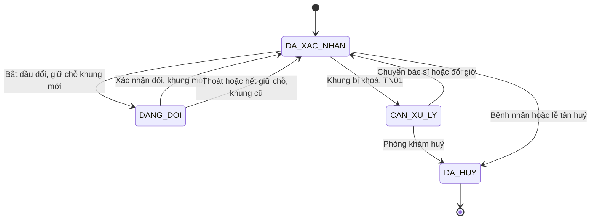
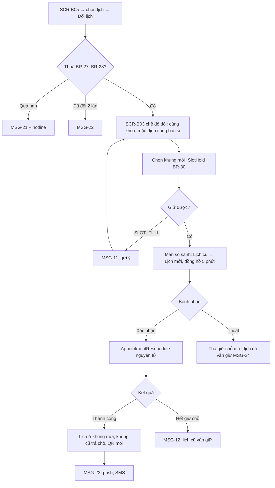
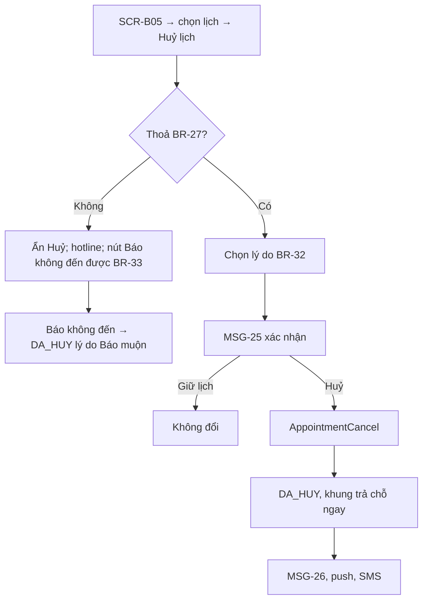
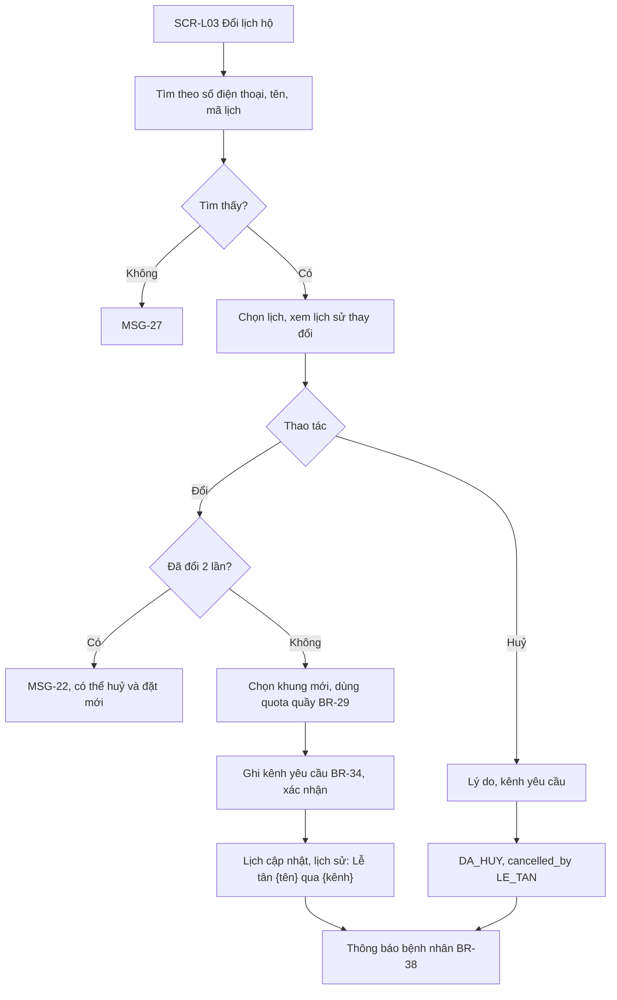
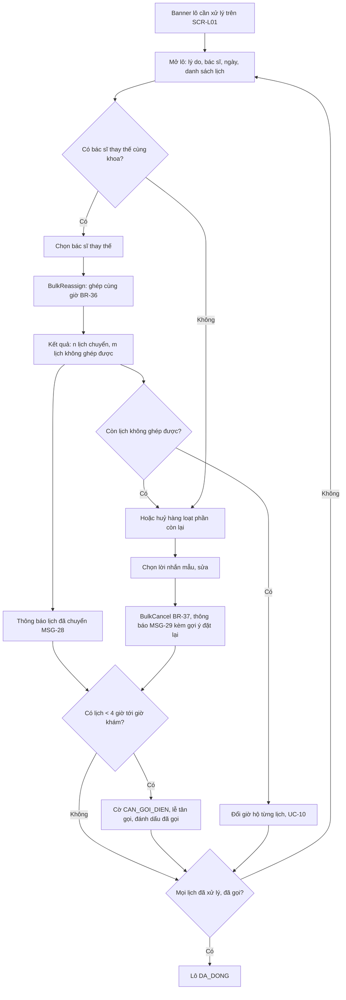
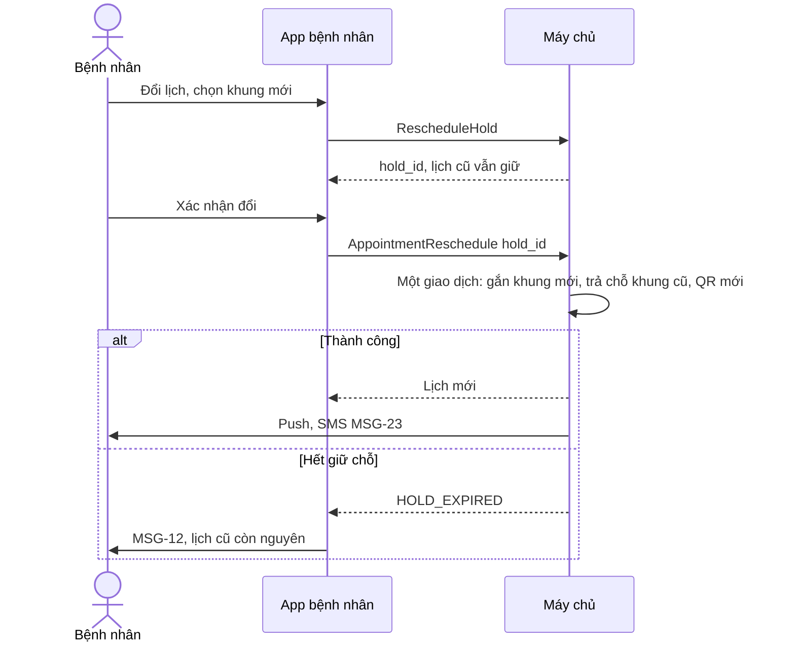

> **Mã:** DE07-TN03-SRS · **Trạng thái:** nháp · **Người viết:** Design (mock) · **PRD:** [PRD.md](PRD.md)

# UC-DE07-03 - Đổi và huỷ lịch

> **Bản mock.** Giá trị `[giả định]` cần BA xác nhận. Giữ chỗ dùng lại cơ chế ở [SRS TN02](../TN02-dat-lich/SRS.md); lịch cần xử lý sinh ra ở [SRS TN01](../TN01-lich-lam-viec-khung-gio/SRS.md).

## 1. Tổng quan

| **Mục** | **Nội dung** |
| --- | --- |
| Mục tiêu | Bệnh nhân đổi, huỷ lịch theo chính sách; lễ tân đổi, huỷ hộ; phòng khám chuyển hoặc huỷ hàng loạt lịch bị ảnh hưởng |
| Actor | Bệnh nhân · Lễ tân · Quản trị · App bệnh nhân · Web lễ tân · Máy chủ · Dịch vụ SMS |
| Phạm vi | Lịch hẹn của tôi, đổi lịch an toàn, huỷ có lý do, chính sách hạn, đổi hộ, huỷ hộ, lô cần xử lý, chuyển và huỷ hàng loạt, lịch sử thay đổi |
| Ngoài phạm vi | Phí huỷ, danh sách chờ, chuyển cho người khám khác, đổi chuyên khoa |
| Nền tảng | App bệnh nhân; Web lễ tân `[giả định]` |

## 2. User Story

| **ID** | **As a** | **I want** | **So that** |
| --- | --- | --- | --- |
| US-11 | Bệnh nhân | Đổi giờ mà vẫn giữ lịch cũ cho tới khi có lịch mới | Không mất chỗ |
| US-12 | Bệnh nhân | Huỷ nhanh | Trả chỗ cho người khác |
| US-13 | Lễ tân | Đổi, huỷ hộ người gọi điện | Phục vụ người không dùng App |
| US-14 | Lễ tân | Xử lý hàng loạt lịch bị ảnh hưởng | Không bỏ sót bệnh nhân |
| US-15 | Bệnh nhân | Được báo sớm khi phòng khám huỷ, có gợi ý lịch mới | Không mất công đến |

## 3. Business Rules

| **Mã** | **Quy tắc** |
| --- | --- |
| BR-27 | **Hạn tự phục vụ**: bệnh nhân đổi, huỷ trên App khi `start_at − hiện tại ≥ 2 giờ` và lịch `DA_XAC_NHAN` `[giả định]` |
| BR-28 | **Số lần đổi** tối đa 2 mỗi lịch hẹn (tính cả đổi hộ); đếm trong `reschedule_count` |
| BR-29 | **Phạm vi đổi**: cùng chuyên khoa, cùng người khám; khung trong cửa sổ mở đặt (BR-07); quota áp dụng như đặt mới (BR-13 với App, quota quầy với lễ tân) |
| BR-30 | **Đổi an toàn**: giữ chỗ khung mới theo BR-17 (không thả lịch cũ). Xác nhận đổi trong một giao dịch: chuyển lịch sang khung mới, giảm đếm của khung cũ, giữ nguyên mã lịch hẹn, cấp QR mới, `reschedule_count + 1` |
| BR-31 | **Giới hạn khi đổi**: bỏ qua lịch đang đổi khi kiểm tra BR-21 |
| BR-32 | **Huỷ**: bắt buộc lý do (Bận việc, Đã khỏi, Đặt nhầm, Khám nơi khác, Khác + ghi chú); lịch `DA_HUY`, khung giảm đếm ngay; ghi `cancelled_by` (BENH_NHAN, LE_TAN, PHONG_KHAM) |
| BR-33 | **Sau hạn** trên App: ẩn Đổi, Huỷ; hiện hotline và "Báo không đến được" → lịch `DA_HUY` lý do "Báo muộn", vẫn trả chỗ `[giả định]` |
| BR-34 | **Lễ tân đổi, huỷ hộ** được mọi lúc trước khi check-in; bắt buộc ghi kênh yêu cầu (Điện thoại, Tại quầy). Lịch `DA_CHECK_IN` **chưa được gọi** cũng đổi, huỷ hộ được trong hai trường hợp: bác sĩ hết giờ làm (TN04 UC-15 A1) hoặc bác sĩ nghỉ đột xuất (TN01 UC-04 A1). Chuyển sang bác sĩ khác trong cùng buổi → giữ `DA_CHECK_IN`, cấp số thứ tự mới của bác sĩ mới, giữ `priority_time`. Đổi sang ngày khác → lịch về `DA_XAC_NHAN` ở khung mới, số thứ tự cũ bị huỷ, không tính lượt đổi. **Lễ tân đặt lịch trước hộ** (kênh `QUAY`): tạo lịch `DA_XAC_NHAN` vào quota quầy của khung (TN01 BR-05), tăng `booked_desk`; áp dụng BR-20–22 về người khám, giới hạn lịch, lý do khám; không cần giữ chỗ tạm |
| BR-35 | **Lô cần xử lý**: tạo từ BR-09, BR-12 (TN01); gồm các lịch `DA_XAC_NHAN` và lịch `DA_CHECK_IN` chưa được gọi trong khung bị khoá; lịch trong lô có cờ `CAN_XU_LY` và hiện cảnh báo trên **SCR-L01** |
| BR-36 | **Chuyển hàng loạt**: chọn bác sĩ thay thế cùng khoa; với từng lịch, ghép vào khung cùng `start_at` của bác sĩ đó nếu còn chỗ (dùng cả quota online và quầy); lịch không ghép được ở lại trong lô |
| BR-37 | **Huỷ hàng loạt**: lời nhắn mẫu (sửa được); lịch `DA_HUY` lý do "Phòng khám huỷ"; thông báo kèm nút đặt lại với 3 khung gợi ý gần nhất cùng khoa. Đặt lại từ thông báo không tính vào BR-21 trong 24 giờ |
| BR-38 | **Thông báo**: mọi thay đổi gửi push cho chủ tài khoản và SMS cho số liên hệ người khám. Lịch có `start_at` < 4 giờ kể từ lúc phòng khám đổi, huỷ → cờ `CAN_GOI_DIEN`; lô chỉ đóng khi cờ được lễ tân đánh dấu đã gọi |

## 4. Trạng thái

### 4.1 Lịch hẹn trong phạm vi SRS này

`DANG_DOI` và `CAN_XU_LY` là cờ đi kèm lịch `DA_XAC_NHAN`, không thay đổi việc lịch vẫn giữ chỗ cũ. Lịch đang có cờ `CAN_XU_LY` không được nhắc lịch và không bị tự chuyển `KHONG_DEN` (TN04 BR-39, BR-47): bệnh nhân không có lỗi khi phòng khám chưa xử lý xong lô.

### 4.2 Trạng thái lô cần xử lý

| **Trạng thái** | **Điều kiện** | **Hiển thị trên Web lễ tân** |
| --- | --- | --- |
| `MO` | Còn lịch chưa xử lý hoặc chưa gọi | Banner đỏ, số lịch còn lại |
| `DANG_XU_LY` | Đã chạy chuyển hoặc huỷ một phần | Thanh tiến độ |
| `DA_DONG` | Mọi lịch đã chuyển hoặc huỷ, mọi cờ gọi điện đã đánh dấu | Lưu trong lịch sử |

## 5. Use Case

### UC-08 Bệnh nhân đổi lịch

| **Mục** | **Nội dung** |
| --- | --- |
| Tiền điều kiện | Lịch `DA_XAC_NHAN`, thoả BR-27, BR-28 |
| Hậu điều kiện thành công | Lịch ở khung mới; khung cũ trả chỗ; QR mới |
| Hậu điều kiện thất bại | Lịch giữ nguyên khung cũ |

**Luồng chính**

| **Bước** | **Actor** | **Mô tả** |
| --- | --- | --- |
| 1 | Bệnh nhân | **SCR-B05** → chọn lịch → "Đổi lịch" |
| 2 | App | Kiểm tra BR-27, BR-28; mở **SCR-B03** chế độ đổi (BR-29) |
| 3 | Bệnh nhân | Chọn khung mới |
| 4 | Máy chủ | Giữ chỗ khung mới (BR-30); lịch cũ không đổi |
| 5 | App | Màn so sánh cũ → mới với đồng hồ giữ chỗ |
| 6 | Bệnh nhân | Bấm "Xác nhận đổi" |
| 7 | Máy chủ | \[AppointmentReschedule\] trong một giao dịch (BR-30) |
| 8 | App | Vé khám cập nhật; thông báo (BR-38) |

### UC-09 Bệnh nhân huỷ lịch

| **Mục** | **Nội dung** |
| --- | --- |
| Tiền điều kiện | Lịch `DA_XAC_NHAN` thuộc tài khoản đang đăng nhập |
| Hậu điều kiện | Thành công: lịch `DA_HUY`, chỗ trả về khung, huỷ các lần nhắc. Thất bại: lịch giữ nguyên |

**Luồng chính**

| **Bước** | **Actor** | **Mô tả** |
| --- | --- | --- |
| 1 | Bệnh nhân | **SCR-B05** → chọn lịch → Huỷ lịch |
| 2 | Hệ thống | Kiểm tra BR-27 (còn ≥ 2 giờ trước giờ khám) |
| 3 | Bệnh nhân | Chọn lý do (BR-32) |
| 4 | Hệ thống | MSG-25 hỏi xác nhận |
| 5 | Bệnh nhân | Chọn Huỷ |
| 6 | Hệ thống | Gọi \[AppointmentCancel\]: lịch `DA_HUY`, khung trả chỗ ngay |
| 7 | Hệ thống | MSG-26; gửi push, SMS |

**Luồng thay thế**

| **Mã** | **Điều kiện** | **Xử lý** |
| --- | --- | --- |
| A1 | Chọn Giữ lịch ở MSG-25 | Lịch không đổi |
| A2 | Không thoả BR-27 | Ẩn nút Huỷ, hiện hotline và nút "Báo không đến được" (BR-33); bấm → lịch `DA_HUY` với lý do "Báo muộn" |

**Luồng lỗi**

| **Mã** | **Điều kiện** | **Xử lý** |
| --- | --- | --- |
| E1 | Huỷ thất bại (mất mạng, lịch vừa đổi trạng thái) | Báo lỗi, tải lại trạng thái lịch; lịch giữ nguyên |

### UC-10 Lễ tân đổi, huỷ hộ

| **Mục** | **Nội dung** |
| --- | --- |
| Tiền điều kiện | Lễ tân đăng nhập; lịch chưa check-in, hoặc đã check-in nhưng chưa được gọi trong hai trường hợp của BR-34 |
| Hậu điều kiện | Lịch được đổi hoặc huỷ; lịch sử ghi lễ tân và kênh yêu cầu |

**Luồng chính**

| **Bước** | **Actor** | **Mô tả** |
| --- | --- | --- |
| 1 | Lễ tân | Mở **SCR-L03** Đổi lịch hộ; tìm theo số điện thoại, tên, mã lịch |
| 2 | Lễ tân | Chọn lịch, xem lịch sử thay đổi |
| 3 | Lễ tân | Chọn Đổi, chọn khung mới (dùng được quota quầy, BR-29) |
| 4 | Lễ tân | Ghi kênh yêu cầu (BR-34), xác nhận |
| 5 | Hệ thống | Cập nhật lịch; lịch sử ghi "Lễ tân {tên} qua {kênh}" |
| 6 | Hệ thống | Thông báo bệnh nhân (BR-38) |

**Luồng thay thế**

| **Mã** | **Điều kiện** | **Xử lý** |
| --- | --- | --- |
| A1 | Chọn Huỷ | Nhập lý do, kênh yêu cầu → lịch `DA_HUY`, `cancelled_by` = `LE_TAN` → thông báo bệnh nhân |
| A2 | Bệnh nhân gọi điện hoặc đến quầy để đặt lịch trước, chưa có lịch | Bấm "Đặt lịch mới" trên **SCR-L03**: tìm hoặc tạo người khám, chọn khoa hoặc bác sĩ, chọn khung còn quota quầy, nhập lý do khám, ghi kênh yêu cầu → \[DeskAppointmentCreate\] tạo lịch `DA_XAC_NHAN` kênh `QUAY` (BR-34); bệnh nhân nhận SMS xác nhận kèm mã lịch hẹn |
| A3 | Lịch `DA_CHECK_IN` chưa được gọi, bác sĩ hết giờ làm hoặc nghỉ đột xuất | Chuyển bác sĩ cùng buổi (cấp số mới, giữ `priority_time`) hoặc đổi sang ngày khác (về `DA_XAC_NHAN`, huỷ số cũ); báo trực tiếp cho bệnh nhân tại phòng chờ (BR-34) |

**Luồng lỗi**

| **Mã** | **Điều kiện** | **Xử lý** |
| --- | --- | --- |
| E1 | Không tìm thấy lịch | MSG-27 |
| E2 | Lịch đã đổi 2 lần | MSG-22; có thể huỷ và đặt lịch mới |

### UC-11 Xử lý hàng loạt lịch bị ảnh hưởng

| **Mục** | **Nội dung** |
| --- | --- |
| Tiền điều kiện | Có lô `MO` (BR-35) |
| Hậu điều kiện thành công | Lô `DA_DONG`; mọi bệnh nhân được thông báo, gọi điện khi cần |
| Hậu điều kiện thất bại | Lô vẫn `MO`/`DANG_XU_LY`; cảnh báo còn trên **SCR-L01** |

**Luồng chính**

| **Bước** | **Actor** | **Mô tả** |
| --- | --- | --- |
| 1 | Lễ tân | Mở lô từ banner trên **SCR-L01**: lý do, bác sĩ, ngày, danh sách lịch |
| 2 | Lễ tân | Chọn bác sĩ thay thế cùng khoa |
| 3 | Hệ thống | Gọi \[BulkReassign\]: ghép cùng giờ (BR-36); báo số lịch đã chuyển và số lịch không ghép được |
| 4 | Hệ thống | Gửi MSG-28 cho các lịch đã chuyển |
| 5 | Lễ tân | Xử lý phần còn lại: đổi giờ hộ từng lịch (UC-10) hoặc huỷ hàng loạt |
| 6 | Hệ thống | Mọi lịch đã xử lý và đã gọi điện khi cần → lô `DA_DONG` |

**Luồng thay thế**

| **Mã** | **Điều kiện** | **Xử lý** |
| --- | --- | --- |
| A1 | Không có bác sĩ thay thế | Chọn lời nhắn mẫu, sửa nếu cần → \[BulkCancel\] (BR-37), gửi MSG-29 kèm gợi ý đặt lại |
| A2 | Có lịch còn dưới 4 giờ tới giờ khám | Gắn cờ `CAN_GOI_DIEN`; lễ tân gọi rồi đánh dấu đã gọi |

**Luồng lỗi**

| **Mã** | **Điều kiện** | **Xử lý** |
| --- | --- | --- |
| E1 | Còn lịch chưa xử lý hoặc chưa gọi | Lô giữ `MO` hoặc `DANG_XU_LY`; banner còn trên **SCR-L01** (MSG-30) |

## 6. Điểm vào

| **Điểm vào** | **Dẫn tới** | **Ghi chú** |
| --- | --- | --- |
| SCR-B05 Lịch hẹn của tôi | UC-08, UC-09 | |
| Vé khám **SCR-B06** → Đổi lịch, Huỷ lịch | UC-08, UC-09 | |
| Thông báo nhắc lịch → Đổi lịch | UC-08 | SRS TN04 |
| Thông báo phòng khám huỷ → Đặt lại | **SCR-B03** với gợi ý | BR-37 |
| Web lễ tân → Đổi lịch hộ | UC-10, **SCR-L03** | |
| Web lễ tân → Đổi lịch hộ → Đặt lịch mới | UC-10 (A2), **SCR-L03** | Đặt lịch trước qua điện thoại, tại quầy |
| Banner lô trên **SCR-L01**; Web quản trị sau nghỉ đột xuất | UC-11 | |

## 7. Mô tả màn hình

### SCR-B05 Lịch hẹn của tôi

| **#** | **Thành phần** | **Loại** | **Hành vi** |
| --- | --- | --- | --- |
| 1 | Tab | Tabs | Sắp tới · Đã qua · Đã huỷ |
| 2 | Lọc người khám | Chips | Tất cả, từng người khám |
| 3 | Thẻ lịch | Card | Người khám, bác sĩ, khoa, ngày giờ, trạng thái; nhãn "Đã chuyển bác sĩ", "Phòng khám đã huỷ" nếu có |
| 4 | Hành động | Buttons | Xem vé · Đổi lịch · Huỷ lịch (ẩn theo BR-27, BR-28, thay bằng lý do và hotline) |
| 5 | Lịch sử thay đổi | Expand | Thời gian, ai thay đổi, nội dung |

### Màn so sánh đổi lịch (App)

| **#** | **Thành phần** | **Hành vi** |
| --- | --- | --- |
| 1 | Lịch cũ | Gạch nhẹ, ghi "Vẫn được giữ cho tới khi bạn xác nhận" |
| 2 | Lịch mới | Nổi bật, kèm đồng hồ giữ chỗ |
| 3 | Số lần đổi còn lại | "Bạn còn {n} lần đổi cho lịch này" |
| 4 | Xác nhận đổi · Quay lại | Buttons |

### SCR-L03 Đổi lịch hộ (Web lễ tân)

| **#** | **Thành phần** | **Loại** | **Hành vi** |
| --- | --- | --- | --- |
| 1 | Tìm kiếm | Search | Số điện thoại, tên, mã lịch |
| 2 | Kết quả | Table | Người khám, tài khoản, ngày giờ, bác sĩ, trạng thái, số lần đã đổi |
| 3 | Chi tiết lịch | Panel | Lịch sử thay đổi, lý do khám (ẩn mặc định, bấm để xem, có nhật ký truy cập) |
| 4 | Đổi | Lưới khung | Khung cùng khoa, quota quầy |
| 5 | Huỷ | Form | Lý do, kênh yêu cầu |

### Lô cần xử lý (Web lễ tân)

| **#** | **Thành phần** | **Loại** | **Hành vi** |
| --- | --- | --- | --- |
| 1 | Đầu lô | Header | Lý do, bác sĩ, ngày, trạng thái, tiến độ "{x}/{y} đã xử lý" |
| 2 | Danh sách lịch | Table chọn nhiều | Giờ, người khám, số điện thoại, kết quả (Đã chuyển, Đã huỷ, Chưa xử lý), cờ "Cần gọi điện" |
| 3 | Chuyển hàng loạt | Action | Chọn bác sĩ thay thế; xem trước số lịch ghép được |
| 4 | Huỷ hàng loạt | Action | Lời nhắn mẫu, sửa được |
| 5 | Đánh dấu đã gọi | Checkbox mỗi dòng | Ghi người gọi, thời điểm, kết quả cuộc gọi |

## 8. API

| **API** | **Request chính** | **Response chính** | **Timeout / retry** `[giả định]` |
| --- | --- | --- | --- |
| \[MyAppointments\] | account_id, tab, patient_id | Lịch hẹn, quyền đổi, huỷ, lý do không được | 3s / 1 lần |
| \[RescheduleHold\] | appointment_id, new_slot_id | hold_id, expires_at hoặc SLOT_FULL | 3s / không tự retry |
| \[AppointmentReschedule\] | appointment_id, hold_id, actor, channel | appointment mới (cùng mã, QR mới) | 5s / gửi lại cùng hold_id |
| \[AppointmentCancel\] | appointment_id, reason, actor, channel | status `DA_HUY` | 5s / 2 lần |
| \[AppointmentSearch\] (lễ tân) | phone, name, code | Lịch hẹn | 3s / 1 lần |
| \[DeskAppointmentCreate\] (lễ tân) | patient_id hoặc thông tin người khám, slot_id, reason, channel | appointment_id, code; hoặc SLOT_FULL khi hết quota quầy | 5s / gửi lại cùng request_id |
| \[ImpactBatchGet\] | batch_id | Lô, lịch, trạng thái, cờ gọi | 3s / 1 lần |
| \[BulkReassign\] | batch_id, appointment_ids, new_doctor_id | Kết quả từng lịch | 15s / 1 lần |
| \[BulkCancel\] | batch_id, appointment_ids, message | Kết quả từng lịch | 15s / 1 lần |
| \[CallMark\] | appointment_id, result | – | 3s / 2 lần |

**Map lỗi → thông báo**

| **Nhóm lỗi** | **Message** |
| --- | --- |
| Đổi, huỷ khi còn dưới 2 giờ | MSG-21 |
| Vượt số lần đổi lịch | MSG-22 |
| Giữ chỗ khung mới thất bại hoặc hết hạn | MSG-24, lịch cũ giữ nguyên |
| Không tìm thấy lịch hẹn | MSG-27 |
| Mất mạng, lỗi máy chủ | Thông báo lỗi chung của app (ngoài bộ MSG của SRS này), cho thử lại |

## 9. Danh sách thông báo

| **ID** | **Nơi hiện** | **Nội dung (VI)** |
| --- | --- | --- |
| MSG-21 | Inline | Chỉ đổi, huỷ trên App trước giờ khám 2 giờ. Vui lòng gọi {hotline} để được hỗ trợ |
| MSG-22 | Inline | Lịch này đã đổi 2 lần. Bạn có thể huỷ và đặt lịch mới |
| MSG-23 | Push, SMS | Đã đổi lịch {người khám} sang {giờ, ngày} với {bác sĩ}. Mã {code} |
| MSG-24 | Toast | Lịch cũ của bạn vẫn được giữ |
| MSG-25 | Popup | Huỷ lịch khám {giờ, ngày} của {người khám}? \[Giữ lịch\] \[Huỷ lịch\] |
| MSG-26 | Push, SMS | Đã huỷ lịch khám {giờ, ngày} của {người khám} |
| MSG-27 | Inline | Không tìm thấy lịch hẹn phù hợp |
| MSG-28 | Push, SMS | {Bác sĩ cũ} không thể khám ngày {d}. Lịch của {người khám} đã chuyển sang {bác sĩ mới}, giữ nguyên giờ {giờ}. \[Đổi lịch khác\] \[Huỷ\] |
| MSG-29 | Push, SMS | Phòng khám rất tiếc phải huỷ lịch {giờ, ngày} của {người khám}: {lời nhắn}. \[Đặt lại\] |
| MSG-30 | Banner Web lễ tân | Còn {n} lịch cần xử lý, trong đó {m} lịch cần gọi điện |

## 10. Yêu cầu phi chức năng

| **Mục** | **Yêu cầu** `[giả định]` |
| --- | --- |
| Nhất quán | Đổi lịch là một giao dịch; không có thời điểm nào lịch hẹn mất cả chỗ cũ lẫn chỗ mới |
| Hiệu năng | Chuyển, huỷ hàng loạt 50 lịch ≤ 10 giây; thông báo gửi ≤ 1 phút sau thao tác |
| Bảo mật | Lễ tân xem lý do khám phải bấm mở, có nhật ký truy cập |
| Audit | Lịch sử thay đổi lịch hẹn không xoá được: thời gian, actor, kênh, trước, sau |
| Tracking | Bắt đầu, xác nhận, bỏ đổi; huỷ (lý do, actor); báo muộn; chuyển, huỷ hàng loạt; số lịch cần gọi |
| Accessibility | Lý do không đổi, huỷ được ghi rõ bằng chữ; màn so sánh đọc được theo thứ tự cũ → mới |
