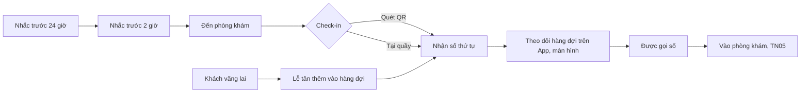

> **Mã:** DE07-TN04-PRD · **Trạng thái:** nháp · **Người viết:** Design (mock) · **SRS:** [SRS.md](SRS.md)

# PRD Nhắc lịch, check-in và số thứ tự (Đặt lịch khám phòng khám)

> **Bản mock.** Con số đánh dấu `[giả định]` dùng để dựng flow, cần PO xác nhận trước khi dùng.

## 1. Bối cảnh và vấn đề

### 1.1 Bối cảnh

Từ lúc đặt lịch ([TN02](../TN02-dat-lich/PRD.md)) tới lúc vào phòng khám ([TN05](../TN05-kham-ghi-nhan-ket-qua/PRD.md)), bệnh nhân cần nhớ lịch, đến đúng giờ, báo đã đến và biết bao giờ tới lượt. Phòng chờ thường đông và ồn, có cả người đặt lịch và khách vãng lai. Lễ tân phải sắp xếp hàng đợi sao cho công bằng: người có lịch không bị chen, người đến trễ không làm loạn hàng.

### 1.2 Vấn đề

| **Vấn đề** | **Hệ quả** |
| --- | --- |
| Bệnh nhân quên lịch | Không đến, chỗ trống |
| Xếp hàng ở quầy chỉ để báo đã đến | Quầy quá tải giờ cao điểm |
| Đến đúng giờ nhưng vẫn chờ lâu vì khách vãng lai | Bệnh nhân có lịch thấy bất công |
| Không biết còn bao nhiêu người trước mình | Không dám rời phòng chờ |
| Gọi số bằng loa, nghe không rõ | Bỏ lượt, phải gọi lại |
| Đến trễ không biết xử lý thế nào | Tranh cãi tại quầy |

### 1.3 Mục tiêu

- Tỉ lệ không đến ≤ 10% `[giả định]`.
- ≥ 50% bệnh nhân có lịch tự check-in bằng QR `[giả định]`.
- Bệnh nhân có lịch, đến đúng giờ, được gọi trong ≤ 15 phút sau giờ hẹn ở ≥ 80% lượt `[giả định]`.

## 2. Người dùng

| **Nhóm** | **Nhu cầu với tính năng này** |
| --- | --- |
| Bệnh nhân có lịch | Được nhắc, check-in nhanh, biết còn bao lâu |
| Người lớn tuổi | Check-in tại quầy, nhìn số trên màn to |
| Khách vãng lai | Được khám khi còn chỗ, biết phải chờ bao lâu |
| Lễ tân | Check-in nhanh, thêm vãng lai, xử lý đến trễ, xem toàn cảnh hàng đợi |

## 3. Phạm vi

### 3.1 Trong phạm vi (MVP)

- Nhắc lịch trước 24 giờ và 2 giờ (push, SMS); xác nhận sẽ đến hoặc đổi, huỷ từ nhắc.
- Check-in từ 60 phút trước giờ hẹn: quét QR ở kiosk hoặc quầy, hoặc lễ tân tìm theo số điện thoại.
- Số thứ tự theo bác sĩ, ưu tiên theo giờ hẹn.
- Khách vãng lai: lễ tân thêm vào hàng đợi khi còn chỗ hoặc vượt sức chứa có giới hạn.
- Đến trễ: trong 15 phút giữ thứ tự; trễ hơn xếp sau người đúng giờ; quá 30 phút là không đến.
- Hàng đợi realtime trên App và màn gọi số trong phòng chờ.
- Gọi số, gọi lại, bỏ lượt.

### 3.2 Ngoài phạm vi

- Kiosk tự in số giấy (dùng QR trên điện thoại hoặc phiếu từ quầy).
- Ưu tiên người cao tuổi, phụ nữ có thai tự động → phase sau.
- Check-in từ xa bằng vị trí GPS.
- Thanh toán tại quầy.

## 4. Nguyên tắc sản phẩm

### 4.1 Người có lịch được tôn trọng

Bệnh nhân đúng giờ được xếp theo giờ hẹn, không bị khách vãng lai chen trước.

### 4.2 Báo đến không cần xếp hàng

Quét QR là xong. Quầy dành cho người cần hỗ trợ.

### 4.3 Biết vị trí của mình trong hàng

App và màn hình phòng chờ luôn hiện số đang khám và số người phía trước.

### 4.4 Quy tắc đến trễ rõ ràng, nói trước

Quy tắc được ghi trên vé khám và trong tin nhắc lịch, lễ tân không phải tự quyết.

## 5. Quy tắc nghiệp vụ

| **Quy tắc** | **Giá trị** `[giả định]` |
| --- | --- |
| Nhắc lịch | 24 giờ và 2 giờ trước giờ hẹn; không gửi 22:00–06:00 (dời sang 06:00) |
| Mở check-in | 60 phút trước giờ hẹn |
| Đến trễ | ≤ 15 phút: giữ thứ tự theo giờ hẹn; 15–30 phút: xếp sau người đã check-in đúng giờ; > 30 phút: Không đến |
| Số thứ tự | Theo bác sĩ trong ngày; có lịch: A001…; vãng lai: W001… |
| Thứ tự gọi | Người có lịch đã check-in và đến giờ hẹn trước; vãng lai xen vào khi khung giờ còn trống; vãng lai vượt sức chứa chỉ được gọi khi không có người có lịch nào đã đến giờ hẹn |
| Vãng lai vượt sức chứa | Tối đa 3 người mỗi buổi mỗi bác sĩ |
| Gọi lại | Tối đa 3 lần cách nhau 2 phút; không có mặt → bỏ lượt, có thể xếp lại cuối hàng |

- Các giá trị trên là **cấu hình theo phòng khám**, không cố định trong code.

## 6. Luồng trải nghiệm

| **Bước** | **Giai đoạn** | **Trải nghiệm** | **Đầu ra** |
| --- | --- | --- | --- |
| 1 | Nhắc lịch | Tin nhắc 24 giờ có nút Xác nhận sẽ đến, Đổi, Huỷ | Bệnh nhân nhớ lịch |
| 2 | Trên đường | Tin nhắc 2 giờ kèm địa chỉ, phòng, quy tắc đến trễ | Đến đúng giờ |
| 3 | Check-in | Quét QR ở kiosk, hoặc đưa mã cho lễ tân | Số thứ tự |
| 4 | Chờ | App: số đang khám, số người phía trước, ước tính thời gian | Yên tâm chờ |
| 5 | Gọi số | Màn phòng chờ hiện số và phòng; App rung, thông báo | Vào phòng |

## 7. Use Cases, User Stories và Acceptance Criteria

### UC1. Nhắc lịch

User Story: Là bệnh nhân, tôi muốn được nhắc trước giờ khám để không quên và kịp đổi lịch nếu bận.

AC01: Nhắc trước 24 giờ và 2 giờ qua push; SMS nếu push không gửi được hoặc người khám dùng số khác chủ tài khoản.

AC02: Tin nhắc 24 giờ có nút Xác nhận sẽ đến, Đổi lịch, Huỷ lịch.

AC03: Tin nhắc 2 giờ có địa chỉ, phòng, giờ nên có mặt, quy tắc đến trễ.

AC04: Lịch bị đổi hoặc huỷ → huỷ các nhắc cũ, lên lịch nhắc mới.

### UC2. Check-in

#### US2.1 Tự check-in bằng QR

User Story: Là bệnh nhân, tôi muốn tự check-in bằng QR để không phải xếp hàng ở quầy.

AC01: Quét QR vé khám ở kiosk hoặc quầy trong khoảng 60 phút trước giờ hẹn tới 30 phút sau.

AC02: Check-in thành công → số thứ tự, phòng, số người phía trước hiện trên kiosk và App.

AC03: Quét quá sớm → báo giờ mở check-in.

AC04: Quét quá muộn (> 30 phút) → báo không còn hiệu lực, mời gặp lễ tân.

#### US2.2 Check-in tại quầy

User Story: Là lễ tân, tôi muốn check-in tại quầy nhanh cho người không dùng app để quầy không ùn.

AC01: Lễ tân tìm theo số điện thoại, tên, mã; bấm Check-in.

AC02: Lễ tân in phiếu số thứ tự cho người không có điện thoại.

AC03: Người khám dưới 16 tuổi → lễ tân xác nhận có người giám hộ.

### UC3. Hàng đợi

#### US3.1 Theo dõi lượt

User Story: Là bệnh nhân, tôi muốn biết còn bao nhiêu người trước mình để không phải ngồi canh màn hình.

AC01: App hiện số của mình, số đang khám, số người phía trước, thời gian ước tính.

AC02: Còn 2 người phía trước → thông báo "Sắp tới lượt".

AC03: Màn phòng chờ hiện từng bác sĩ: phòng, số đang khám, 3 số kế tiếp.

#### US3.2 Đến trễ

User Story: Là lễ tân, tôi muốn có quy tắc đến trễ rõ ràng để không phải tự quyết, tránh tranh cãi.

AC01: Trễ ≤ 15 phút → giữ vị trí theo giờ hẹn.

AC02: Trễ 15–30 phút → xếp sau những người đã check-in đúng giờ, báo rõ cho bệnh nhân.

AC03: Trễ > 30 phút → lịch thành Không đến; lễ tân có thể thêm như khách vãng lai.

### UC4. Khách vãng lai

AC01: Lễ tân chọn chuyên khoa hoặc bác sĩ, xem chỗ trống còn lại trong buổi.

AC02: Còn chỗ (kể cả phần giữ của quầy) → tạo lịch và check-in ngay, số W…

AC03: Hết chỗ → thêm vượt tối đa 3 người mỗi buổi, báo thời gian chờ dự kiến dài.

AC04: Nhập thông tin người khám tối thiểu: họ tên, năm sinh, số điện thoại.

### UC5. Gọi số

AC01: Bác sĩ hoặc điều dưỡng bấm Gọi người tiếp theo (TN05) → màn phòng chờ hiện số, âm báo; App rung.

AC02: Không có mặt → gọi lại tối đa 3 lần cách 2 phút; rồi bỏ lượt.

AC03: Người bỏ lượt quay lại → lễ tân xếp lại cuối hàng.

## 8. Chỉ số theo dõi `[giả định]`

| **Chỉ số** | **Định nghĩa** | **Mục tiêu MVP** |
| --- | --- | --- |
| Tỉ lệ không đến | `KHONG_DEN` / lịch đến hạn | ≤ 10% |
| Tỉ lệ xác nhận từ nhắc | Lịch bấm Xác nhận sẽ đến / lịch được nhắc 24 giờ | Theo dõi |
| Tỉ lệ tự check-in | Check-in bằng QR / tổng check-in có lịch | ≥ 50% |
| Thời gian chờ có lịch | Từ max(giờ hẹn, giờ check-in) tới được gọi | ≤ 15 phút ở ≥ 80% lượt |
| Thời gian chờ vãng lai | Từ check-in tới được gọi | Theo dõi |
| Tỉ lệ bỏ lượt | Bỏ lượt / lượt gọi | ≤ 3% |

## 9. Phụ thuộc và rủi ro

| **Mục** | **Mô tả** | **Hướng xử lý** |
| --- | --- | --- |
| Mất mạng tại phòng khám | Không check-in, màn gọi số đứng | Lễ tân check-in dự phòng; màn gọi số giữ trạng thái cuối, báo lỗi |
| Ước tính thời gian sai | Bệnh nhân rời đi, lỡ lượt | Hiện khoảng thời gian, không con số chính xác; báo "Sắp tới lượt" |
| Vãng lai làm trễ người có lịch | Mất niềm tin vào đặt lịch | Thuật toán ưu tiên có lịch; giới hạn vượt sức chứa |
| Dữ liệu trên màn phòng chờ | Lộ tên bệnh nhân | Màn chỉ hiện số thứ tự, không hiện tên |

## 10. Câu hỏi mở

> Câu nào đã có giá trị ở mục 5 thì giá trị đó là **tạm chốt** `[giả định]` để dựng flow. Câu hỏi vẫn để mở cho đến khi PO xác nhận.

- Có ưu tiên người cao tuổi, trẻ nhỏ, phụ nữ có thai ở MVP?
- Mở check-in 60 phút trước có quá sớm cho phòng khám nhỏ?
- Số thứ tự theo bác sĩ hay theo chuyên khoa?
- Có cần kiosk riêng hay dùng tablet ở quầy?
