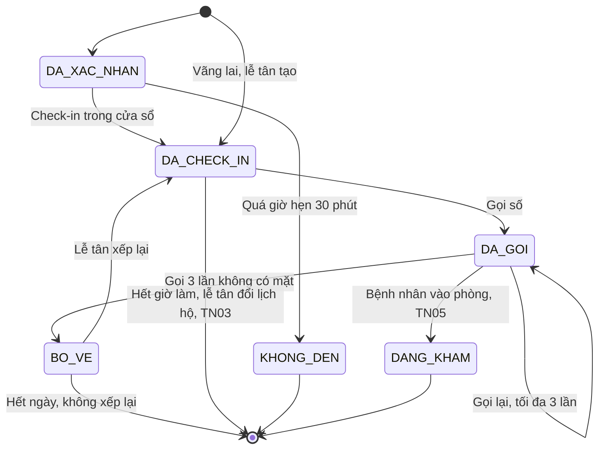
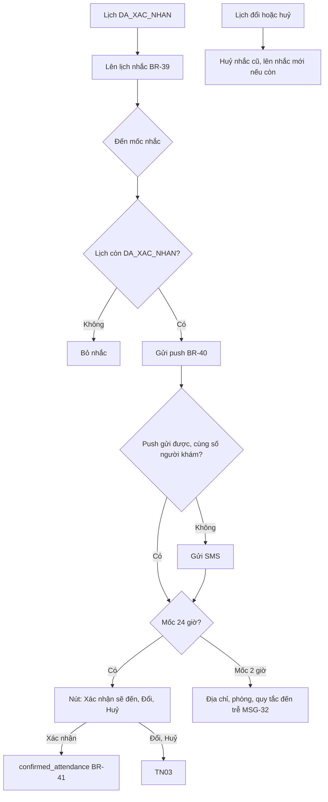
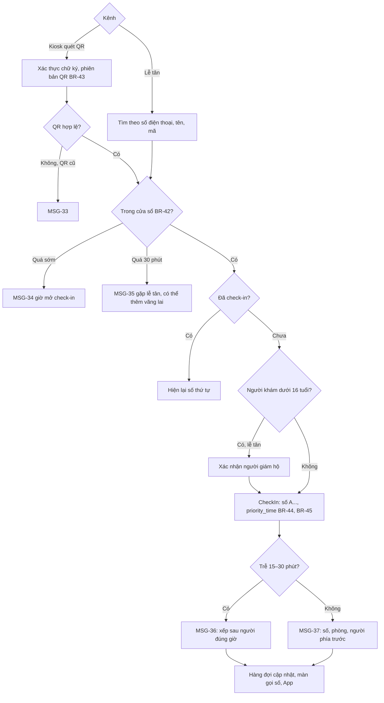
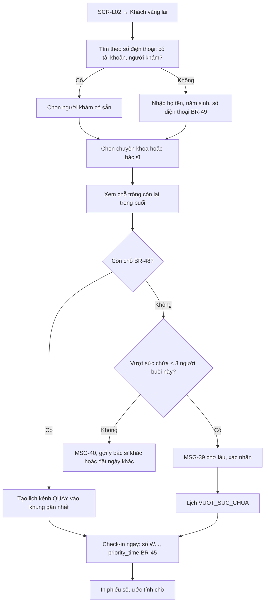
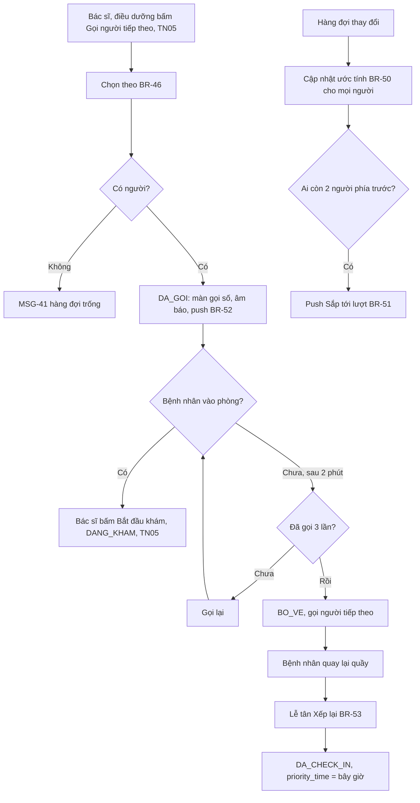
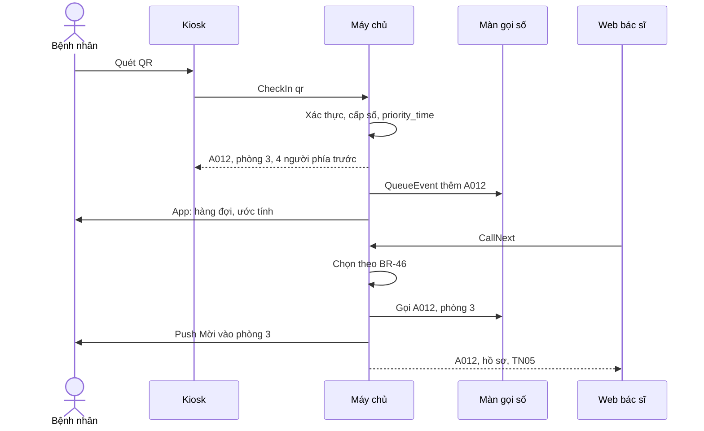

> **Mã:** DE07-TN04-SRS · **Trạng thái:** nháp · **Người viết:** Design (mock) · **PRD:** [PRD.md](PRD.md)

# UC-DE07-04 - Nhắc lịch, check-in và số thứ tự

> **Bản mock.** Giá trị `[giả định]` cần BA xác nhận. SRS này mô tả lịch từ `DA_XAC_NHAN` tới khi được gọi vào phòng (`DANG_KHAM`), kèm `KHONG_DEN`, `BO_VE`; phiên khám xem [SRS TN05](../TN05-kham-ghi-nhan-ket-qua/SRS.md).

## 1. Tổng quan

| **Mục** | **Nội dung** |
| --- | --- |
| Mục tiêu | Nhắc lịch, check-in bằng QR hoặc tại quầy, cấp số thứ tự, sắp hàng đợi công bằng, gọi số, xử lý đến trễ, vãng lai, không đến |
| Actor | Bệnh nhân · Lễ tân · Bác sĩ, điều dưỡng (gọi số) · App bệnh nhân · Web lễ tân · Kiosk · Màn gọi số · Máy chủ · Dịch vụ SMS |
| Phạm vi | Nhắc lịch, xác nhận sẽ đến, check-in, phiếu số, hàng đợi, ước tính chờ, sắp tới lượt, gọi, gọi lại, bỏ lượt, vãng lai, không đến |
| Ngoài phạm vi | Ưu tiên tự động theo đối tượng, check-in bằng GPS, in số tự động ở kiosk, thanh toán |
| Nền tảng | App bệnh nhân; Web lễ tân; Kiosk (tablet ở cửa); Màn gọi số (TV) `[giả định]` |
| Figma | `[chưa có]` |

## 2. User Story

| **ID** | **As a** | **I want** | **So that** |
| --- | --- | --- | --- |
| US-16 | Bệnh nhân | Được nhắc lịch, xác nhận hoặc đổi ngay từ tin nhắc | Không quên, không bỏ chỗ trống |
| US-17 | Bệnh nhân | Tự check-in bằng QR | Không phải xếp hàng ở quầy |
| US-18 | Bệnh nhân | Biết còn bao nhiêu người trước mình | Chờ yên tâm |
| US-19 | Lễ tân | Check-in, thêm vãng lai nhanh | Quầy không ùn |
| US-20 | Lễ tân | Có quy tắc đến trễ rõ ràng | Không phải tự quyết, tránh tranh cãi |
| US-21 | Bác sĩ | Gọi người tiếp theo đúng thứ tự | Khám liên tục |

## 3. Business Rules

| **Mã** | **Quy tắc** |
| --- | --- |
| BR-39 | **Nhắc lịch** lúc `start_at − 24 giờ` và `start_at − 2 giờ`; giờ rơi vào 22:00–06:00 thì dời sang 06:00 (nếu vẫn trước `start_at`). Lịch đặt trong vòng 24 giờ chỉ nhắc mốc 2 giờ; trong vòng 2 giờ không nhắc |
| BR-40 | **Kênh nhắc**: push cho chủ tài khoản; SMS khi push lỗi, khi tắt thông báo, hoặc khi số người khám khác số chủ tài khoản |
| BR-41 | **Xác nhận sẽ đến** từ nhắc 24 giờ: ghi `confirmed_attendance = true`; không đổi trạng thái lịch |
| BR-42 | **Cửa sổ check-in**: từ `start_at − 60 phút` tới `start_at + 30 phút`; ngoài cửa sổ App, kiosk từ chối; lễ tân check-in được tới `start_at + 30 phút` |
| BR-43 | **QR check-in**: ký số, gắn mã lịch hẹn và phiên bản QR (đổi lịch cấp QR mới, QR cũ vô hiệu); mỗi lịch check-in 1 lần |
| BR-44 | **Số thứ tự** theo bác sĩ trong ngày: có lịch `A{nnn}`, vãng lai `W{nnn}`, tăng dần theo thời điểm check-in |
| BR-45 | **Mốc ưu tiên** `priority_time`: có lịch, check-in trước hoặc trễ ≤ 15 phút → `start_at`; trễ 15–30 phút → thời điểm check-in + 15 phút; vãng lai → thời điểm check-in, hoặc `start_at` của khung trống được gán `[giả định]` |
| BR-46 | **Thứ tự gọi**: trong những người `DA_CHECK_IN` của bác sĩ, gọi người có `priority_time` nhỏ nhất mà `priority_time ≤ hiện tại + 10 phút`; không ai thoả → gọi người có `priority_time` nhỏ nhất |
| BR-47 | **Không đến**: tác vụ mỗi phút chuyển lịch `DA_XAC_NHAN` có `start_at + 30 phút < hiện tại` sang `KHONG_DEN`; trả chỗ cho khung (không còn ý nghĩa đặt online nhưng lễ tân thấy chỗ trống) |
| BR-48 | **Vãng lai**: lễ tân tạo lịch kênh `QUAY` vào khung gần nhất còn chỗ (dùng quota quầy, rồi quota online còn trống); không còn chỗ → `VUOT_SUC_CHUA`, tối đa 3 mỗi buổi mỗi bác sĩ; lịch vãng lai check-in ngay |
| BR-49 | **Thông tin vãng lai tối thiểu**: họ tên, năm sinh, số điện thoại; lễ tân có thể liên kết với tài khoản sẵn có theo số điện thoại |
| BR-50 | **Ước tính chờ** = số người phía trước × thời lượng lượt khám của bác sĩ; hiện dạng khoảng "{a}–{b} phút" (±30%); cập nhật mỗi khi hàng đợi thay đổi |
| BR-51 | **Sắp tới lượt**: còn 2 người phía trước → push "Sắp tới lượt", một lần |
| BR-52 | **Gọi số**: hiện số và phòng trên màn gọi số, âm báo, push cho bệnh nhân; lịch `DA_GOI`. Gọi lại tối đa 3 lần, cách ≥ 2 phút; sau lần 3 không có mặt → `BO_VE` |
| BR-53 | **Bỏ lượt quay lại**: lễ tân "Xếp lại" → `DA_CHECK_IN` với `priority_time` = hiện tại, số giữ nguyên |
| BR-54 | **Màn gọi số** chỉ hiện số thứ tự và phòng, không hiện tên hay thông tin y tế |

## 4. Trạng thái

### 4.1 Lịch hẹn trong phạm vi SRS này

### 4.2 Mỗi vai trò thấy gì

| **Trạng thái** | **App bệnh nhân** | **Web lễ tân** | **Màn gọi số** |
| --- | --- | --- | --- |
| `DA_XAC_NHAN` | Vé khám; "Check-in từ {giờ}" | Lịch trong ngày, "Chưa đến" | – |
| `DA_CHECK_IN` | Số, phòng, số người phía trước, ước tính | "Đã đến {giờ}", số thứ tự, trễ (nếu có) | Trong 3 số kế tiếp |
| `DA_GOI` | "Mời vào phòng {p}", rung | "Đang gọi lần {n}" | Số và phòng, nhấp nháy |
| `BO_VE` | "Bạn đã bị bỏ lượt, vui lòng gặp lễ tân" | Nút "Xếp lại" | – |
| `KHONG_DEN` | "Không đến" trong lịch đã qua | "Không đến" | – |

## 5. Use Case

### UC-12 Nhắc lịch

### UC-13 Check-in

| **Mục** | **Nội dung** |
| --- | --- |
| Tiền điều kiện | Lịch `DA_XAC_NHAN` |
| Hậu điều kiện thành công | Lịch `DA_CHECK_IN` với số thứ tự, `priority_time` |
| Hậu điều kiện thất bại | Lịch giữ nguyên; bệnh nhân được hướng dẫn gặp lễ tân |

**Luồng chính (kiosk)**

| **Bước** | **Actor** | **Mô tả** |
| --- | --- | --- |
| 1 | Bệnh nhân | Mở vé khám trên App, đưa QR vào kiosk |
| 2 | Kiosk | Gửi \[CheckIn\] với QR |
| 3 | Máy chủ | Xác thực BR-43, kiểm tra BR-42; cấp số (BR-44), tính `priority_time` (BR-45) |
| 4 | Kiosk | Hiện số thứ tự, phòng, số người phía trước trong 10 giây |
| 5 | App | Vé khám chuyển sang màn hàng đợi (**SCR-B06**) |

**Luồng thay thế**

| **Mã** | **Điều kiện** | **Xử lý** |
| --- | --- | --- |
| A1 | Lễ tân check-in hộ | Tìm, bấm Check-in; in phiếu số nếu cần |
| A2 | Trễ 15–30 phút | MSG-36 (BR-45) |
| A3 | Người khám dưới 16 tuổi (tại quầy) | Lễ tân xác nhận người giám hộ |
| A4 | Đã check-in rồi | Hiện lại số |

**Luồng lỗi**

| **Mã** | **Điều kiện** | **Xử lý** |
| --- | --- | --- |
| E1 | QR không hợp lệ, QR cũ sau khi đổi lịch | MSG-33 |
| E2 | Ngoài cửa sổ | MSG-34 hoặc MSG-35 |
| E3 | Kiosk mất mạng | MSG-38, mời gặp lễ tân |

### UC-14 Thêm khách vãng lai

### UC-15 Hàng đợi và gọi số

| **Mục** | **Nội dung** |
| --- | --- |
| Tiền điều kiện | Có người `DA_CHECK_IN` của bác sĩ |
| Hậu điều kiện | Người được gọi vào phòng (`DANG_KHAM`) hoặc `BO_VE` |

**Luồng thay thế**

| **Mã** | **Điều kiện** | **Xử lý** |
| --- | --- | --- |
| A1 | Hết giờ làm của bác sĩ mà còn người `DA_CHECK_IN` | Bác sĩ khám hết hàng đợi nếu được. Không được thì lễ tân đổi lịch hộ sang ngày gần nhất, không tính lượt đổi và không áp dụng hạn 2 giờ (TN03); bệnh nhân nhận thông báo kèm lời xin lỗi `[giả định]` |
| A2 | Lịch `BO_VE` tới hết ngày không được xếp lại | Giữ `BO_VE`, kết thúc; thống kê cùng nhóm với `KHONG_DEN` |
| A3 | Bệnh nhân đến sau khi lịch đã `KHONG_DEN` | Kiosk, App báo MSG-35; lễ tân tạo lượt vãng lai (UC-14), liên kết với hồ sơ người khám sẵn có |

### UC-16 Tự động chuyển Không đến

| **Bước** | **Actor** | **Mô tả** |
| --- | --- | --- |
| 1 | Tác vụ | Mỗi phút tìm lịch `DA_XAC_NHAN` có `start_at + 30 phút < hiện tại` |
| 2 | Máy chủ | Chuyển `KHONG_DEN` (BR-47); huỷ nhắc còn lại |
| 3 | Web lễ tân | Lịch hiện "Không đến"; nếu bệnh nhân tới sau → thêm như vãng lai (UC-14) |

## 6. Điểm vào

| **Điểm vào** | **Dẫn tới** | **Ghi chú** |
| --- | --- | --- |
| Thông báo nhắc lịch | UC-12 | Nút Xác nhận, Đổi, Huỷ |
| Kiosk ở cửa | UC-13 | Quét QR |
| Web lễ tân **SCR-L01**, **SCR-L02** | UC-13, UC-14 | |
| Vé khám **SCR-B06** sau check-in | Hàng đợi | Tự làm mới |
| Nút Gọi người tiếp theo ở **SCR-D01** | UC-15 | SRS TN05 |

## 7. Mô tả màn hình

### SCR-L01 Lịch trong ngày (Web lễ tân)

| **#** | **Thành phần** | **Loại** | **Hành vi** |
| --- | --- | --- | --- |
| 1 | Cảnh báo | Banner | Bác sĩ nghỉ, lô cần xử lý (TN01, TN03) |
| 2 | Bộ lọc | Toolbar | Chuyên khoa, bác sĩ, trạng thái, tìm theo tên, số điện thoại, mã |
| 3 | Bảng lịch | Table theo giờ | Giờ, số thứ tự, người khám, bác sĩ, kênh (App, Quầy), trạng thái (mục 4.2), trễ, đã xác nhận sẽ đến |
| 4 | Hành động dòng | Buttons | Check-in · In phiếu · Đổi hộ · Huỷ hộ · Xếp lại (với `BO_VE`) |
| 5 | Tổng quan hàng đợi | Side panel | Mỗi bác sĩ: số đang khám, số người chờ, thời gian chờ dài nhất |

### SCR-L02 Check-in, vãng lai (Web lễ tân)

| **#** | **Thành phần** | **Loại** | **Bắt buộc** | **Hành vi** |
| --- | --- | --- | --- | --- |
| 1 | Quét QR, tìm kiếm | Input | – | Máy quét hoặc gõ |
| 2 | Thông tin lịch | Card | – | Người khám, tuổi, bác sĩ, giờ hẹn, trễ |
| 3 | Xác nhận giám hộ | Checkbox | Khi < 16 tuổi | |
| 4 | Vãng lai | Form | Họ tên, năm sinh, số điện thoại | BR-49 |
| 5 | Chỗ trống | Grid | – | Khung còn chỗ theo bác sĩ; số vượt sức chứa còn lại |
| 6 | Kết quả | Card + In | – | Số thứ tự, phòng, ước tính chờ |

### SCR-B06 Vé khám, hàng đợi (App)

| **#** | **Thành phần** | **Loại** | **Hành vi** |
| --- | --- | --- | --- |
| 1 | Trước check-in | Card | QR, "Check-in từ {giờ} đến {giờ}", quy tắc đến trễ |
| 2 | Số của tôi | Số lớn | A{nnn} hoặc W{nnn}, phòng |
| 3 | Đang khám | Text | Số đang khám của bác sĩ |
| 4 | Phía trước | Text | "{n} người · khoảng {a}–{b} phút" |
| 5 | Được gọi | Overlay | "Mời {số} vào phòng {p}", rung, âm thanh |
| 6 | Bỏ lượt | Banner | MSG-42 |

### SCR-T01 Màn gọi số (TV phòng chờ)

| **#** | **Thành phần** | **Loại** | **Hành vi** |
| --- | --- | --- | --- |
| 1 | Cột mỗi bác sĩ | Grid | Tên bác sĩ, phòng, số đang khám (cỡ lớn), 3 số kế tiếp |
| 2 | Đang gọi | Overlay | Số + phòng cỡ ≥ 160 px, nhấp nháy 5 giây, âm báo, đọc số bằng giọng nói `[giả định]` |
| 3 | Mất kết nối | Banner | "Đang kết nối lại…" giữ trạng thái cuối |

## 8. API

| **API** | **Request chính** | **Response chính** | **Timeout / retry** `[giả định]` |
| --- | --- | --- | --- |
| \[ReminderJob\] | – | Gửi nhắc BR-39, BR-40 | Chạy mỗi phút |
| \[AttendanceConfirm\] | appointment_id | – | 3s / 2 lần |
| \[CheckIn\] | qr hoặc appointment_id, channel, guardian_confirmed | queue_number, room, priority_time, ahead_count, late_status | 3s / gửi lại cùng request_id |
| \[WalkInCreate\] | patient info hoặc patient_id, doctor_id hoặc department_id | appointment_id, queue_number, eta | 5s / 2 lần |
| \[QueueGet\] | doctor_id hoặc appointment_id | Đang khám, hàng đợi, eta | 3s / 1 lần |
| \[QueueEvent\] (máy chủ → App, màn gọi số, Web) | doctor_id, thay đổi | – | Kết nối realtime |
| \[CallNext\] | doctor_id | appointment gọi, queue_number | 3s / 1 lần |
| \[Recall\] | appointment_id | call_count | 3s / 1 lần |
| \[Requeue\] | appointment_id | priority_time mới | 3s / 2 lần |
| \[NoShowJob\] | – | Chuyển `KHONG_DEN` BR-47 | Chạy mỗi phút |

## 9. Danh sách thông báo

| **ID** | **Nơi hiện** | **Nội dung (VI)** |
| --- | --- | --- |
| MSG-31 | Push, SMS (24 giờ) | Nhắc lịch: {người khám} khám {bác sĩ} lúc {giờ} ngày mai. \[Xác nhận sẽ đến\] \[Đổi lịch\] \[Huỷ\] |
| MSG-32 | Push, SMS (2 giờ) | {Người khám} khám lúc {giờ} tại {địa chỉ}, phòng {p}. Đến trễ quá 15 phút sẽ được xếp sau người đúng giờ |
| MSG-33 | Kiosk | Mã QR không còn hiệu lực. Vui lòng mở vé khám mới nhất trên App hoặc gặp lễ tân |
| MSG-34 | Kiosk, App | Check-in mở từ {giờ}. Vui lòng quay lại sau |
| MSG-35 | Kiosk | Đã quá giờ check-in. Vui lòng gặp lễ tân để được hỗ trợ |
| MSG-36 | Kiosk, App | Bạn đến trễ {n} phút nên sẽ được xếp sau những người đến đúng giờ. Số của bạn: {số} |
| MSG-37 | Kiosk, App | Check-in thành công. Số {số}, phòng {p}, {n} người phía trước |
| MSG-38 | Kiosk | Chưa kết nối được. Vui lòng gặp lễ tân |
| MSG-39 | Popup lễ tân | Buổi này đã hết chỗ. Thêm vượt sức chứa ({x}/3), thời gian chờ có thể trên {n} phút? \[Huỷ\] \[Thêm\] |
| MSG-40 | Inline lễ tân | Đã đạt giới hạn vượt sức chứa của buổi. Gợi ý: {bác sĩ khác} hoặc đặt ngày khác |
| MSG-41 | Toast bác sĩ | Hàng đợi đang trống |
| MSG-42 | Banner App | Bạn đã bị bỏ lượt vì không có mặt khi được gọi. Vui lòng gặp lễ tân để được xếp lại |
| MSG-43 | Push | Sắp tới lượt bạn! Còn 2 người phía trước, vui lòng có mặt gần phòng {p} |
| MSG-44 | Push | Mời số {số} vào phòng {p} |

Bản EN: `[chờ bổ sung]`.

## 10. Yêu cầu phi chức năng

| **Mục** | **Yêu cầu** `[giả định]` |
| --- | --- |
| Hiệu năng | Check-in ≤ 1 giây; sự kiện hàng đợi tới màn gọi số và App ≤ 2 giây |
| Tin cậy | Nhắc lịch gửi đúng giờ ± 2 phút; không nhắc lịch đã đổi, huỷ; màn gọi số tự kết nối lại và lấy đủ trạng thái |
| Riêng tư | Màn gọi số không hiện tên (BR-54); SMS không chứa lý do khám; QR không chứa thông tin cá nhân |
| Công bằng | Ghi nhật ký mọi lần gọi, gọi lại, xếp lại để đối chiếu khi có khiếu nại |
| Tracking | Nhắc (kênh, mở, xác nhận), check-in (kênh, sớm, trễ), vãng lai (có chỗ, vượt), thời gian chờ, gọi lại, bỏ lượt, không đến |
| Accessibility | Màn gọi số chữ lớn, tương phản cao, có âm báo và đọc số; App rung và thông báo khi được gọi; quầy hỗ trợ người không dùng điện thoại |
