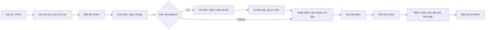

> **Mã:** DE07-TN05-PRD · **Trạng thái:** nháp · **Người viết:** Design (mock) · **SRS:** [SRS.md](SRS.md)

# PRD Khám và ghi nhận kết quả (Đặt lịch khám phòng khám)

> **Bản mock.** Con số đánh dấu `[giả định]` dùng để dựng flow, cần PO xác nhận trước khi dùng. Nội dung y khoa chỉ để minh hoạ luồng, cần bác sĩ duyệt.

## 1. Bối cảnh và vấn đề

### 1.1 Bối cảnh

Bệnh nhân đã check-in và vào hàng đợi ([TN04](../TN04-nhac-lich-checkin-so-thu-tu/PRD.md)). Trong phòng khám, bác sĩ có khoảng 10–20 phút cho mỗi người: hỏi bệnh, khám, chỉ định xét nghiệm nếu cần, kê đơn, hẹn tái khám. Sau buổi khám, bệnh nhân cần xem lại kết quả và đơn thuốc. Đây là phần nhạy cảm nhất của sản phẩm vì chạm tới dữ liệu sức khoẻ.

### 1.2 Vấn đề

| **Vấn đề** | **Hệ quả** |
| --- | --- |
| Bác sĩ không thấy lý do khám, tiền sử trước khi gọi | Hỏi lại từ đầu, mất thời gian |
| Ghi kết quả trên giấy | Khó đọc, bệnh nhân làm mất đơn thuốc |
| Chỉ định xét nghiệm, bệnh nhân không biết đi đâu, quay lại thế nào | Chờ lâu, mất lượt |
| Hẹn tái khám miệng | Bệnh nhân quên, không đặt lại |
| Dữ liệu y tế xem được bởi nhiều người | Rủi ro lộ thông tin sức khoẻ |

### 1.3 Mục tiêu

- Bác sĩ ghi nhận kết quả một lượt khám trong ≤ 3 phút thao tác `[giả định]`.
- 100% lượt khám hoàn thành có kết quả trên App trong ≤ 15 phút `[giả định]`.
- ≥ 60% lịch tái khám được đặt từ hẹn tái khám của bác sĩ `[giả định]`.

## 2. Người dùng

| **Nhóm** | **Nhu cầu với tính năng này** |
| --- | --- |
| Bác sĩ | Hàng đợi rõ, thông tin bệnh nhân trước khi vào, ghi kết quả nhanh bằng mẫu |
| Điều dưỡng | Gọi số, ghi sinh hiệu (huyết áp, nhiệt độ) trước khi bác sĩ khám |
| Bệnh nhân | Xem lại chẩn đoán, đơn thuốc, lời dặn; đặt tái khám dễ dàng |
| Người đặt hộ | Xem kết quả của người thân mình quản lý |

## 3. Phạm vi

### 3.1 Trong phạm vi (MVP)

- Hàng đợi của bác sĩ trong buổi; gọi người tiếp theo (TN04).
- Phiên khám: thông tin người khám, lý do khám, ảnh đính kèm, tiền sử các lần khám tại phòng khám.
- Sinh hiệu do điều dưỡng hoặc bác sĩ nhập.
- Ghi nhận: triệu chứng, chẩn đoán (chọn từ danh mục hoặc gõ), ghi chú, lời dặn.
- Chỉ định cận lâm sàng: chọn xét nghiệm, chẩn đoán hình ảnh; bệnh nhân đi làm rồi quay lại; kết quả nhập thủ công.
- Đơn thuốc: thuốc, liều, số ngày, cách dùng; mẫu đơn hay dùng.
- Hẹn tái khám: số ngày; bệnh nhân đặt từ App.
- Kết thúc khám, ký số đơn giản; bệnh nhân xem kết quả, đơn thuốc trên App.
- Bác sĩ sửa kết quả trong 24 giờ, có lịch sử.

### 3.2 Ngoài phạm vi

- Hồ sơ bệnh án điện tử đầy đủ theo chuẩn, liên thông.
- Kết nối máy xét nghiệm, PACS.
- Kê đơn thuốc điện tử liên thông nhà thuốc.
- Thanh toán viện phí, bảo hiểm.
- Khám từ xa.

## 4. Nguyên tắc sản phẩm

### 4.1 Bác sĩ biết trước khi bệnh nhân bước vào

Lý do khám, tiền sử, sinh hiệu hiện ngay khi gọi số. Bác sĩ không phải hỏi lại những gì bệnh nhân đã khai.

### 4.2 Ghi nhanh bằng mẫu, không bằng gõ

Chẩn đoán, đơn thuốc, lời dặn có mẫu và danh mục. Gõ tự do chỉ khi cần.

### 4.3 Chỉ người cần mới thấy

Dữ liệu khám chỉ hiện cho bác sĩ của lượt khám, người khám và chủ tài khoản quản lý người khám. Mọi lần xem đều ghi nhật ký.

### 4.4 Bệnh nhân hiểu được kết quả

Kết quả trên App viết rõ ràng: chẩn đoán, đơn thuốc dạng bảng uống thuốc, lời dặn, ngày tái khám.

## 5. Quy tắc nghiệp vụ

| **Quy tắc** | **Giá trị** `[giả định]` |
| --- | --- |
| Bắt đầu khám | Bác sĩ bấm Bắt đầu khi bệnh nhân vào phòng |
| Chẩn đoán | Bắt buộc ≥ 1 trước khi kết thúc |
| Đơn thuốc | Tuỳ chọn; mỗi thuốc: tên, hàm lượng, liều mỗi lần, số lần mỗi ngày, số ngày, cách dùng |
| Chỉ định cận lâm sàng | Bệnh nhân đi làm, quay lại phòng cùng bác sĩ, được gọi ưu tiên khi có kết quả |
| Hẹn tái khám | 3–90 ngày; bệnh nhân nhận nhắc đặt lịch |
| Sửa kết quả | Trong 24 giờ sau kết thúc, bệnh nhân được báo |
| Quyền xem kết quả | Người khám (≥ 16 tuổi, có tài khoản) và chủ tài khoản quản lý người khám |
| Thời gian kết quả lên App | Ngay khi bác sĩ kết thúc khám |

- Các giá trị trên là **cấu hình theo phòng khám**, không cố định trong code.

## 6. Luồng trải nghiệm

| **Bước** | **Giai đoạn** | **Trải nghiệm** | **Đầu ra** |
| --- | --- | --- | --- |
| 1 | Chuẩn bị | Hàng đợi: người tiếp theo kèm lý do khám, tuổi, tiền sử | Bác sĩ nắm thông tin |
| 2 | Gọi, bắt đầu | Gọi số; bệnh nhân vào, bấm Bắt đầu khám | Phiên khám mở |
| 3 | Khám | Sinh hiệu, triệu chứng; mẫu ghi nhanh | Ghi nhận |
| 4 | Cận lâm sàng | Chọn chỉ định; bệnh nhân đi làm; tạm dừng phiên, gọi người khác | Chờ kết quả |
| 5 | Kết luận | Chẩn đoán, đơn thuốc, lời dặn, hẹn tái khám | Kết quả khám |
| 6 | Kết thúc | Kiểm tra, ký, kết thúc; in đơn nếu bệnh nhân cần | Kết quả lên App |
| 7 | Sau khám | Bệnh nhân xem kết quả, lịch uống thuốc, đặt tái khám | Tái khám |

## 7. Use Cases, User Stories và Acceptance Criteria

### UC1. Hàng đợi và chuẩn bị

#### US1.1 Xem hàng đợi của tôi

User Story: Là bác sĩ, tôi muốn biết ai tiếp theo và họ khám vì sao trước khi gọi.

AC01: Hàng đợi buổi hiện tại: số thứ tự, tên, tuổi, giới, giờ hẹn hoặc vãng lai, lý do khám (rút gọn), cờ tái khám, cờ có kết quả cận lâm sàng.

AC02: Chạm một người → xem trước hồ sơ: lý do khám đầy đủ, ảnh, tiền sử khám tại phòng khám.

AC03: Nút Gọi người tiếp theo (TN04); người có kết quả cận lâm sàng được ưu tiên.

### UC2. Phiên khám

#### US2.1 Ghi nhận khám

User Story: Là bác sĩ, tôi muốn ghi kết quả nhanh bằng mẫu để dành thời gian cho bệnh nhân.

AC01: Bấm Bắt đầu khám khi bệnh nhân vào → phiên khám mở; lịch chuyển Đang khám.

AC02: Sinh hiệu: mạch, huyết áp, nhiệt độ, cân nặng, chiều cao; cảnh báo khi ngoài ngưỡng thường.

AC03: Chẩn đoán chọn từ danh mục (tìm theo tên, mã) hoặc gõ tự do; ít nhất 1 chẩn đoán.

AC04: Lời dặn có mẫu theo chuyên khoa, sửa được.

AC05: Tự lưu nháp mỗi 10 giây.

#### US2.2 Chỉ định cận lâm sàng

User Story: Là bác sĩ, tôi muốn chỉ định xét nghiệm rồi tiếp tục khám người khác để không lãng phí thời gian chờ.

AC01: Chọn xét nghiệm, chẩn đoán hình ảnh từ danh mục của phòng khám; in phiếu chỉ định.

AC02: Phiên khám chuyển Chờ cận lâm sàng; bác sĩ gọi người khác.

AC03: Kỹ thuật viên hoặc điều dưỡng nhập kết quả (số liệu, ảnh, file) → bệnh nhân vào lại hàng đợi, ưu tiên.

AC04: Bác sĩ mở lại phiên khám với kết quả đính kèm.

#### US2.3 Kê đơn và hẹn tái khám

User Story: Là bác sĩ, tôi muốn kê đơn bằng mẫu và hẹn tái khám để ghi nhanh và bệnh nhân không quên tái khám.

AC01: Đơn thuốc từ danh mục thuốc của phòng khám: tên, hàm lượng, liều, số lần mỗi ngày, số ngày, cách dùng (trước, sau ăn); tự tính số lượng.

AC02: Mẫu đơn hay dùng của bác sĩ.

AC03: Cảnh báo khi trùng thuốc trong đơn hoặc người khám có ghi dị ứng `[giả định]`.

AC04: Hẹn tái khám sau N ngày, kèm ghi chú.

#### US2.4 Kết thúc khám

User Story: Là bác sĩ, tôi muốn rà lại rồi kết thúc khám để kết quả đầy đủ và tới bệnh nhân ngay.

AC01: Màn kiểm tra trước khi kết thúc: chẩn đoán, đơn, lời dặn, tái khám.

AC02: Kết thúc → kết quả khoá, ký số, lên App ngay; lịch Hoàn thành.

AC03: In đơn thuốc, kết quả khi bệnh nhân cần.

AC04: Sửa trong 24 giờ có lý do; bệnh nhân được báo có cập nhật.

### UC3. Bệnh nhân xem kết quả

AC01: Kết quả khám: ngày, bác sĩ, chẩn đoán, lời dặn, kết quả cận lâm sàng, đơn thuốc dạng bảng theo buổi (sáng, trưa, tối).

AC02: Hẹn tái khám có nút Đặt lịch, mở đúng bác sĩ và ngày gợi ý (TN02).

AC03: Nhắc đặt tái khám trước ngày hẹn 3 ngày nếu chưa đặt.

AC04: Chỉ người có quyền mới xem được; mở kết quả cần xác thực lại (sinh trắc hoặc mã PIN của App) `[giả định]`.

## 8. Chỉ số theo dõi `[giả định]`

| **Chỉ số** | **Định nghĩa** | **Mục tiêu MVP** |
| --- | --- | --- |
| Thời gian ghi nhận | Thời gian thao tác trên phiên khám | ≤ 3 phút (trung vị) |
| Thời gian một lượt khám | Từ Bắt đầu tới Kết thúc (không tính chờ cận lâm sàng) | Theo dõi theo chuyên khoa |
| Tỉ lệ dùng mẫu | Đơn, lời dặn dùng mẫu / tổng | Theo dõi |
| Tỉ lệ kết quả lên App | Lượt hoàn thành có kết quả trên App ≤ 15 phút / lượt hoàn thành | 100% |
| Tỉ lệ đặt tái khám | Tái khám được đặt / hẹn tái khám | ≥ 60% |
| Tỉ lệ sửa sau kết thúc | Kết quả bị sửa / lượt hoàn thành | Theo dõi |

## 9. Phụ thuộc và rủi ro

| **Mục** | **Mô tả** | **Hướng xử lý** |
| --- | --- | --- |
| Pháp lý dữ liệu y tế | Quy định bảo vệ dữ liệu cá nhân nhạy cảm | Mã hoá, phân quyền chặt, nhật ký truy cập; tư vấn pháp lý `[cần chốt]` |
| Danh mục chẩn đoán, thuốc | Cần danh mục chuẩn, cập nhật | Phòng khám cung cấp, có gõ tự do dự phòng |
| Cảnh báo thuốc | Sai sót có hậu quả nghiêm trọng | MVP chỉ cảnh báo trùng và dị ứng đã ghi; bác sĩ chịu trách nhiệm |
| Bác sĩ ngại nhập liệu | Ghi sơ sài hoặc ghi giấy | Mẫu nhanh, tự lưu, bàn phím tắt |
| Người đặt hộ xem kết quả người lớn | Vi phạm riêng tư | Người khám ≥ 16 tuổi có tài khoản riêng thì quyết định chia sẻ |

## 10. Câu hỏi mở

- Chữ ký số dùng chứng thư của bác sĩ hay xác nhận đơn giản trong hệ thống?
- Người khám ≥ 16 tuổi có tự động thôi chia sẻ với chủ tài khoản không?
- Có cho bệnh nhân tải PDF kết quả không?
- Sửa kết quả sau 24 giờ xử lý thế nào?
