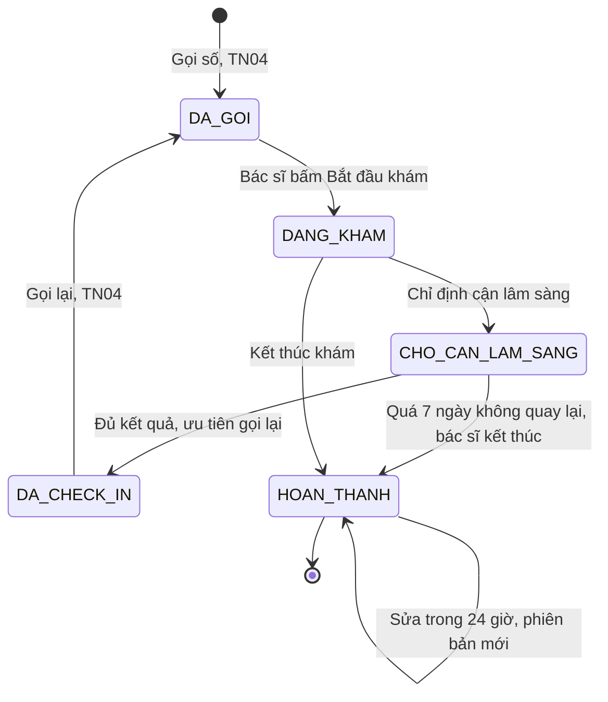
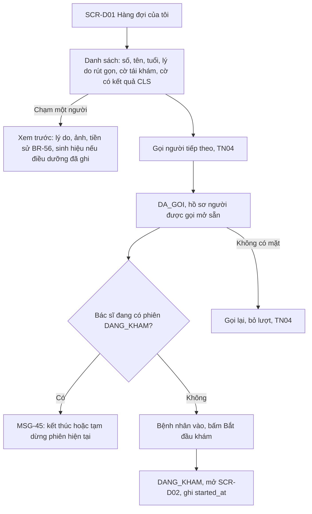
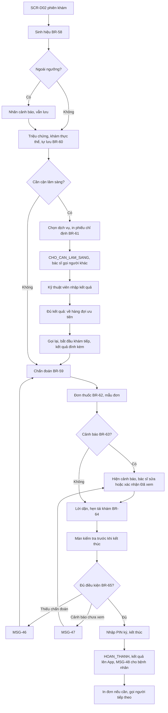
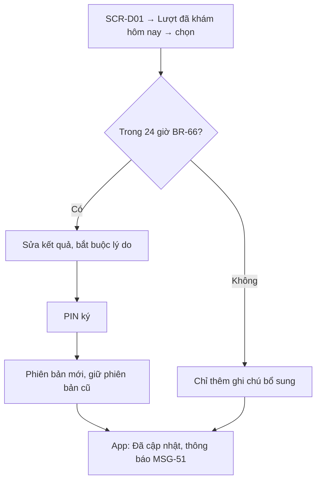
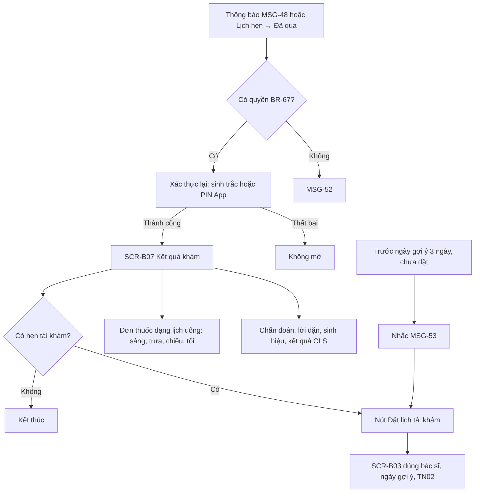
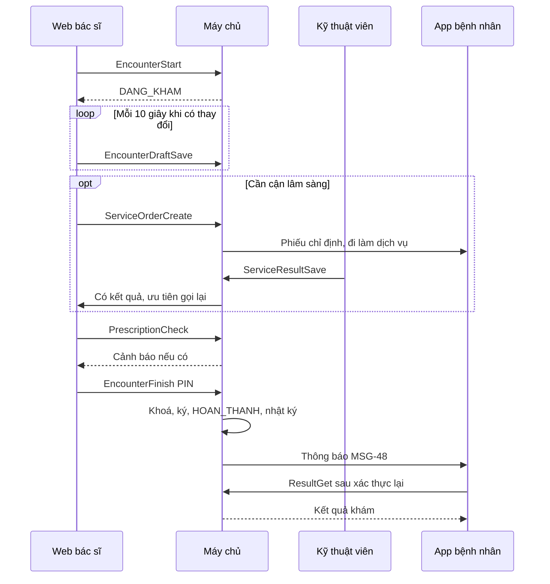

> **Mã:** DE07-TN05-SRS · **Trạng thái:** nháp · **Người viết:** Design (mock) · **PRD:** [PRD.md](PRD.md)

# UC-DE07-05 - Khám và ghi nhận kết quả

> **Bản mock.** Giá trị `[giả định]` cần BA xác nhận. Nội dung y khoa chỉ minh hoạ. SRS này mô tả lịch từ `DA_GOI` tới `HOAN_THANH`; gọi số xem [SRS TN04](../TN04-nhac-lich-checkin-so-thu-tu/SRS.md).

## 1. Tổng quan

| **Mục** | **Nội dung** |
| --- | --- |
| Mục tiêu | Bác sĩ khám theo hàng đợi, ghi sinh hiệu, chẩn đoán, chỉ định, đơn thuốc, hẹn tái khám, kết thúc khám; bệnh nhân xem kết quả và đặt tái khám |
| Actor | Bác sĩ · Điều dưỡng · Kỹ thuật viên cận lâm sàng · Bệnh nhân · Chủ tài khoản · Web bác sĩ · App bệnh nhân · Máy chủ |
| Phạm vi | Hàng đợi bác sĩ, xem trước hồ sơ, phiên khám, sinh hiệu, chẩn đoán, lời dặn, cận lâm sàng, đơn thuốc, cảnh báo, tái khám, kết thúc, sửa, kết quả trên App, quyền xem |
| Ngoài phạm vi | Bệnh án điện tử chuẩn, kết nối máy, đơn thuốc liên thông, viện phí, khám từ xa |
| Nền tảng | Web bác sĩ (tablet, desktop); App bệnh nhân `[giả định]` |
| Figma | `[chưa có]` |

## 2. User Story

| **ID** | **As a** | **I want** | **So that** |
| --- | --- | --- | --- |
| US-22 | Bác sĩ | Xem lý do khám, tiền sử trước khi gọi | Không hỏi lại từ đầu |
| US-23 | Bác sĩ | Ghi chẩn đoán, đơn, lời dặn bằng mẫu | Ghi nhanh |
| US-24 | Bác sĩ | Chỉ định xét nghiệm và tiếp tục khám người khác | Không lãng phí thời gian chờ |
| US-25 | Điều dưỡng | Ghi sinh hiệu trước khi bác sĩ khám | Rút ngắn lượt khám |
| US-26 | Bệnh nhân | Xem kết quả, lịch uống thuốc trên App | Không mất đơn giấy |
| US-27 | Bệnh nhân | Đặt tái khám từ lời hẹn của bác sĩ | Không quên tái khám |

## 3. Business Rules

| **Mã** | **Quy tắc** |
| --- | --- |
| BR-55 | **Quyền theo vai trò**: bác sĩ xem, ghi phiên khám của lịch được phân cho mình và tiền sử của người khám đó; điều dưỡng ghi sinh hiệu, gọi số cho bác sĩ được phân; kỹ thuật viên nhập kết quả cận lâm sàng của phiếu chỉ định; lễ tân không xem nội dung khám |
| BR-56 | **Tiền sử**: các lượt `HOAN_THANH` của người khám tại phòng khám, mới nhất trước: ngày, bác sĩ, chẩn đoán, đơn thuốc; dị ứng đã ghi |
| BR-57 | **Bắt đầu khám**: từ `DA_GOI` → `DANG_KHAM`; ghi `started_at`. Một bác sĩ có tối đa 1 phiên `DANG_KHAM` tại một thời điểm |
| BR-58 | **Sinh hiệu**: mạch (30–220 lần/phút), huyết áp tâm thu/tâm trương (50–260 / 30–160 mmHg), nhiệt độ (34–43 °C), cân nặng (1–300 kg), chiều cao (30–250 cm), SpO2 (50–100%). Ngoài ngưỡng tham chiếu theo tuổi → nhãn cảnh báo, vẫn cho lưu `[giả định]` |
| BR-59 | **Chẩn đoán**: ≥ 1 trước khi kết thúc; chọn từ danh mục (mã, tên) hoặc gõ tự do ≤ 200 ký tự; một chẩn đoán đánh dấu chính |
| BR-60 | **Tự lưu nháp** mỗi 10 giây khi có thay đổi; nháp chỉ bác sĩ của phiên thấy |
| BR-61 | **Chỉ định cận lâm sàng**: chọn ≥ 1 dịch vụ từ danh mục; lịch → `CHO_CAN_LAM_SANG`; bác sĩ hết phiên đang khám, gọi người khác được. Kết quả nhập đủ mọi chỉ định → lịch về `DA_CHECK_IN` với cờ `CO_KET_QUA_CLS`, `priority_time` = hiện tại − 30 phút để được gọi trước `[giả định]` |
| BR-62 | **Đơn thuốc**: mỗi dòng: thuốc (danh mục), hàm lượng, liều mỗi lần, số lần mỗi ngày (1–6), số ngày (1–90), thời điểm (sáng, trưa, chiều, tối), trước hay sau ăn, ghi chú; số lượng = liều × số lần × số ngày, làm tròn lên theo đơn vị đóng gói. Tối đa 15 dòng |
| BR-63 | **Cảnh báo đơn**: trùng hoạt chất trong đơn; hoạt chất trùng dị ứng đã ghi của người khám. Cảnh báo phải được bác sĩ xác nhận "Đã xem" mới kết thúc được `[giả định]` |
| BR-64 | **Hẹn tái khám**: 3–90 ngày, ghi chú ≤ 200 ký tự; tạo lời hẹn gắn bác sĩ và ngày gợi ý; nhắc đặt lịch trước ngày gợi ý 3 ngày nếu chưa đặt |
| BR-65 | **Kết thúc khám**: kiểm tra BR-59, BR-63; khoá kết quả, gắn chữ ký của bác sĩ (xác nhận bằng mã PIN cá nhân) và thời điểm; lịch `HOAN_THANH`; kết quả hiện trên App ngay |
| BR-66 | **Sửa sau kết thúc**: trong 24 giờ, bắt buộc lý do; lưu phiên bản mới, giữ phiên bản cũ; App hiện "Đã cập nhật {giờ}" và gửi thông báo. Quá 24 giờ chỉ thêm ghi chú bổ sung `[giả định]` |
| BR-67 | **Quyền xem kết quả trên App**: người khám có tài khoản riêng (≥ 16 tuổi) và chủ tài khoản đang quản lý người khám đó; người khám ≥ 16 tuổi có thể tắt chia sẻ với chủ tài khoản. Mở màn kết quả cần xác thực lại (sinh trắc học hoặc PIN App) |
| BR-68 | **Nhật ký truy cập**: mọi lần xem, sửa phiên khám, kết quả (nhân viên và App) ghi người, thời gian, hành động; không xoá được |

## 4. Trạng thái

### 4.1 Lịch trong phạm vi SRS này

### 4.2 Phiên khám

| **Trạng thái phiên** | **Điều kiện** | **Web bác sĩ** | **App bệnh nhân** |
| --- | --- | --- | --- |
| `NHAP` | Đang khám, đã có dữ liệu nháp | Form phiên khám, "Đã lưu nháp {giờ}" | "Đang khám" |
| `TAM_DUNG_CLS` | Chờ cận lâm sàng | Trong hàng đợi với nhãn "Chờ CLS" | "Đi làm {dịch vụ}, quay lại phòng {p}" + phiếu chỉ định |
| `DA_KY` | Kết thúc khám | Chỉ xem; Sửa trong 24 giờ | Kết quả khám |
| `DA_SUA` | Có phiên bản sau | Lịch sử phiên bản | "Đã cập nhật {giờ}" |

## 5. Use Case

### UC-17 Chuẩn bị và bắt đầu khám

| **Mục** | **Nội dung** |
| --- | --- |
| Tiền điều kiện | Bác sĩ đăng nhập; có người `DA_CHECK_IN` trong hàng đợi |
| Hậu điều kiện | Lịch `DANG_KHAM`; phiên khám mở |

**Luồng chính**

| **Bước** | **Actor** | **Mô tả** |
| --- | --- | --- |
| 1 | Bác sĩ | Mở **SCR-D01** Hàng đợi của tôi |
| 2 | Hệ thống | Hiện danh sách: số, tên, tuổi, lý do rút gọn, cờ tái khám, cờ có kết quả cận lâm sàng |
| 3 | Bác sĩ | Bấm Gọi người tiếp theo (SRS TN04) |
| 4 | Hệ thống | Lịch `DA_GOI`; hồ sơ người được gọi mở sẵn |
| 5 | Bác sĩ | Bệnh nhân vào phòng, bấm Bắt đầu khám |
| 6 | Hệ thống | Lịch `DANG_KHAM`, mở **SCR-D02**, ghi `started_at` |

**Luồng thay thế**

| **Mã** | **Điều kiện** | **Xử lý** |
| --- | --- | --- |
| A1 | Chạm một người trong hàng đợi | Xem trước lý do, ảnh, tiền sử (BR-56), sinh hiệu nếu điều dưỡng đã ghi |
| A2 | Người được gọi không có mặt | Gọi lại hoặc bỏ lượt (SRS TN04) |

**Luồng lỗi**

| **Mã** | **Điều kiện** | **Xử lý** |
| --- | --- | --- |
| E1 | Bác sĩ đang có phiên `DANG_KHAM` khác | MSG-45: phải kết thúc hoặc chuyển phiên hiện tại sang chờ cận lâm sàng trước |

### UC-18 Ghi nhận khám, chỉ định, kê đơn, kết thúc

| **Mục** | **Nội dung** |
| --- | --- |
| Tiền điều kiện | Lịch `DANG_KHAM` của bác sĩ |
| Hậu điều kiện thành công | Lịch `HOAN_THANH`; kết quả ký và hiện trên App |
| Hậu điều kiện thất bại | Phiên ở `NHAP` hoặc `TAM_DUNG_CLS` |

**Luồng chính**

| **Bước** | **Actor** | **Mô tả** |
| --- | --- | --- |
| 1 | Điều dưỡng hoặc bác sĩ | Nhập sinh hiệu (BR-58) |
| 2 | Bác sĩ | Ghi triệu chứng, khám thực thể; hệ thống tự lưu (BR-60) |
| 3 | Bác sĩ | Chọn chẩn đoán (BR-59) |
| 4 | Bác sĩ | Kê đơn từ danh mục hoặc mẫu (BR-62); xử lý cảnh báo (BR-63) |
| 5 | Bác sĩ | Chọn lời dặn mẫu, hẹn tái khám (BR-64) |
| 6 | Bác sĩ | Mở màn kiểm tra, nhập PIN, bấm "Kết thúc khám" |
| 7 | Máy chủ | Khoá, ký, `HOAN_THANH` (BR-65); đẩy kết quả lên App |

**Luồng thay thế**

| **Mã** | **Điều kiện** | **Xử lý** |
| --- | --- | --- |
| A1 | Cần cận lâm sàng | BR-61; phiên `TAM_DUNG_CLS`; bệnh nhân nhận phiếu chỉ định trên App |
| A2 | Dùng mẫu đơn | Chèn các dòng của mẫu, sửa được từng dòng |
| A3 | Không kê đơn | Bỏ qua bước 4 |
| A4 | Bệnh nhân cần chuyển khoa | Ghi chẩn đoán sơ bộ, lời dặn "Chuyển khám {khoa}", kết thúc; lễ tân đặt lịch khoa khác (TN02) |
| A5 | Bệnh nhân rời đi giữa chừng | Bác sĩ kết thúc với ghi chú "Bệnh nhân bỏ về", chẩn đoán sơ bộ |
| A6 | Hết ngày mà lịch còn `CHO_CAN_LAM_SANG`: kết quả chưa về hoặc bệnh nhân không quay lại | Lịch giữ `CHO_CAN_LAM_SANG` tối đa 7 ngày. Khi đủ kết quả và bệnh nhân quay lại, lễ tân check-in lại cho bác sĩ đã chỉ định, không cần đặt lịch mới. Quá 7 ngày, bác sĩ kết thúc với chẩn đoán sơ bộ và ghi chú "Chưa quay lại sau cận lâm sàng" |

**Luồng lỗi**

| **Mã** | **Điều kiện** | **Xử lý** |
| --- | --- | --- |
| E1 | Mất mạng | Nháp lưu trên máy; banner MSG-49; kết thúc khám chỉ khi có mạng |
| E2 | PIN ký sai | MSG-50; sai 5 lần khoá ký 5 phút |

### UC-19 Sửa kết quả sau khi kết thúc

| **Mục** | **Nội dung** |
| --- | --- |
| Tiền điều kiện | Lịch `HOAN_THANH`; người sửa là bác sĩ của phiên khám |
| Hậu điều kiện | Trong 24 giờ: lưu phiên bản mới, giữ bản cũ, bệnh nhân được báo. Quá 24 giờ: chỉ thêm ghi chú bổ sung (BR-66) |

**Luồng chính**

| **Bước** | **Actor** | **Mô tả** |
| --- | --- | --- |
| 1 | Bác sĩ | **SCR-D01** → Lượt đã khám hôm nay → chọn một lượt |
| 2 | Hệ thống | Kiểm tra còn trong 24 giờ (BR-66) |
| 3 | Bác sĩ | Sửa kết quả, nhập lý do sửa (bắt buộc) |
| 4 | Bác sĩ | Nhập PIN ký |
| 5 | Hệ thống | Lưu phiên bản mới, giữ phiên bản cũ |
| 6 | Hệ thống | App bệnh nhân hiện "Đã cập nhật"; gửi MSG-51 |

**Luồng thay thế**

| **Mã** | **Điều kiện** | **Xử lý** |
| --- | --- | --- |
| A1 | Quá 24 giờ | Chỉ cho thêm ghi chú bổ sung, không sửa nội dung đã ký |

**Luồng lỗi**

| **Mã** | **Điều kiện** | **Xử lý** |
| --- | --- | --- |
| E1 | PIN ký sai | MSG-50, không lưu |

### UC-20 Bệnh nhân xem kết quả và đặt tái khám

| **Mục** | **Nội dung** |
| --- | --- |
| Tiền điều kiện | Lịch `HOAN_THANH`; người xem có quyền theo BR-67 |
| Hậu điều kiện | Người xem đọc kết quả; có thể đặt tái khám |

**Luồng chính**

| **Bước** | **Actor** | **Mô tả** |
| --- | --- | --- |
| 1 | Bệnh nhân | Mở từ thông báo MSG-48, hoặc Lịch hẹn → Đã qua |
| 2 | Hệ thống | Kiểm tra quyền xem (BR-67) |
| 3 | Bệnh nhân | Xác thực lại bằng sinh trắc hoặc PIN App |
| 4 | Hệ thống | Mở **SCR-B07**: chẩn đoán, lời dặn, sinh hiệu, kết quả cận lâm sàng, đơn thuốc dạng lịch uống |
| 5 | Bệnh nhân | Có hẹn tái khám → bấm Đặt lịch tái khám |
| 6 | Hệ thống | Mở **SCR-B03** với đúng bác sĩ và ngày gợi ý (SRS TN02) |

**Luồng thay thế**

| **Mã** | **Điều kiện** | **Xử lý** |
| --- | --- | --- |
| A1 | Không có hẹn tái khám | Kết thúc ở bước 4 |
| A2 | Còn 3 ngày tới ngày gợi ý mà chưa đặt | Gửi nhắc MSG-53, chạm mở bước 5 |

**Luồng lỗi**

| **Mã** | **Điều kiện** | **Xử lý** |
| --- | --- | --- |
| E1 | Không có quyền xem | MSG-52 |
| E2 | Xác thực lại thất bại | Không mở kết quả |

## 6. Điểm vào

| **Điểm vào** | **Dẫn tới** | **Ghi chú** |
| --- | --- | --- |
| Web bác sĩ → Hàng đợi của tôi | UC-17, **SCR-D01** | Buổi hiện tại |
| Gọi số thành công (TN04) | Hồ sơ người được gọi | |
| Web điều dưỡng → Sinh hiệu | Sinh hiệu trên **SCR-D02** | Trước khi bác sĩ bắt đầu |
| Web kỹ thuật viên → Phiếu chỉ định | Nhập kết quả CLS | BR-61 |
| Thông báo "Đã có kết quả khám" | UC-20, **SCR-B07** | |
| Thông báo nhắc tái khám | UC-20 → TN02 | BR-64 |

## 7. Mô tả màn hình

### SCR-D01 Hàng đợi của tôi (Web bác sĩ)

| **#** | **Thành phần** | **Loại** | **Hành vi** |
| --- | --- | --- | --- |
| 1 | Thanh trên | Header | Buổi, phòng, số đã khám / còn chờ, thời gian khám trung bình |
| 2 | Đang khám | Card | Người đang khám, thời gian đã khám; "Mở phiên" |
| 3 | Hàng đợi | List | Số thứ tự, tên, tuổi, giới, giờ hẹn hoặc "Vãng lai", lý do (1 dòng), nhãn "Tái khám", "Có kết quả CLS", "Trễ" |
| 4 | Xem trước | Panel | Lý do đầy đủ, ảnh, tiền sử (BR-56), dị ứng, sinh hiệu |
| 5 | Gọi người tiếp theo | Button lớn | TN04; disabled khi đang có phiên `DANG_KHAM` |
| 6 | Chờ cận lâm sàng | Section | Người đang đi làm CLS, tiến độ kết quả |
| 7 | Đã khám hôm nay | Section | Mở lại để xem, sửa (UC-19) |

### SCR-D02 Phiên khám (Web bác sĩ)

| **#** | **Thành phần** | **Loại** | **Bắt buộc** | **Hành vi** |
| --- | --- | --- | --- | --- |
| 1 | Thông tin người khám | Header cố định | – | Tên, tuổi, giới, dị ứng (nổi bật), lý do khám |
| 2 | Tiền sử | Panel thu gọn | – | BR-56 |
| 3 | Sinh hiệu | Form số | Không | BR-58, nhãn cảnh báo |
| 4 | Triệu chứng, khám | Text + mẫu | Không | |
| 5 | Cận lâm sàng | Multi-select + In phiếu | Không | BR-61; kết quả hiện ngay dưới khi có |
| 6 | Chẩn đoán | Tìm danh mục + gõ tự do | Có | BR-59; chọn chẩn đoán chính |
| 7 | Đơn thuốc | Bảng dòng | Không | BR-62; mẫu đơn; số lượng tự tính; cảnh báo BR-63 ngay trên dòng |
| 8 | Lời dặn | Text + mẫu | Không | |
| 9 | Hẹn tái khám | Số ngày + ghi chú | Không | BR-64 |
| 10 | Trạng thái lưu | Text phụ | – | "Đã lưu nháp lúc {giờ}" / MSG-49 |
| 11 | Kết thúc khám | Button | – | Mở màn kiểm tra, PIN ký |

### SCR-B07 Kết quả khám (App)

| **#** | **Thành phần** | **Loại** | **Hành vi** |
| --- | --- | --- | --- |
| 1 | Đầu kết quả | Header | Người khám, ngày, bác sĩ, chuyên khoa; nhãn "Đã cập nhật {giờ}" nếu có sửa |
| 2 | Chẩn đoán | Card | Tên chẩn đoán dễ hiểu, mã ở dòng phụ |
| 3 | Lời dặn | Card | |
| 4 | Sinh hiệu, kết quả CLS | Card | Số liệu, ảnh, file |
| 5 | Đơn thuốc | Bảng lịch uống | Cột sáng, trưa, chiều, tối; mỗi thuốc: tên, liều, trước hay sau ăn, số ngày; nút "Đặt nhắc uống thuốc" `[giả định]` |
| 6 | Tái khám | Card | "Tái khám sau {n} ngày, khoảng {ngày}" + Đặt lịch |
| 7 | Chia sẻ | Setting | Người khám ≥ 16 tuổi tắt, bật chia sẻ với chủ tài khoản (BR-67) |

## 8. API

| **API** | **Request chính** | **Response chính** | **Timeout / retry** `[giả định]` |
| --- | --- | --- | --- |
| \[DoctorQueueGet\] | doctor_id, session | Đang khám, hàng đợi, chờ CLS, đã khám | 3s / 1 lần |
| \[PatientPreview\] | appointment_id | Lý do, ảnh, tiền sử, dị ứng, sinh hiệu; ghi nhật ký BR-68 | 3s / 1 lần |
| \[EncounterStart\] | appointment_id | encounter_id, status `DANG_KHAM` | 3s / 2 lần |
| \[EncounterDraftSave\] | encounter_id, dữ liệu | saved_at | 3s / lưu máy và gửi lại |
| \[VitalsSave\] | encounter_id, vitals | flags | 3s / 2 lần |
| \[CatalogSearch\] | type (DIAGNOSIS, DRUG, SERVICE), keyword | Kết quả danh mục | 2s / không retry |
| \[ServiceOrderCreate\] | encounter_id, service_ids | order_id, phiếu in | 5s / 2 lần |
| \[ServiceResultSave\] (kỹ thuật viên) | order_id, results, files | Tiến độ, all_done | 8s / 2 lần |
| \[PrescriptionCheck\] | encounter_id, lines | Cảnh báo BR-63 | 3s / 1 lần |
| \[EncounterFinish\] | encounter_id, pin, acknowledged_warnings | status `HOAN_THANH`, version | 5s / gửi lại cùng request_id |
| \[EncounterAmend\] | encounter_id, changes, reason, pin | version mới | 5s / 2 lần |
| \[ResultGet\] (App) | appointment_id, reauth_token | Kết quả phiên bản mới nhất | 5s / 1 lần |

**Map lỗi → thông báo**

| **Nhóm lỗi** | **Message** |
| --- | --- |
| Bắt đầu khám khi đang có phiên khác | MSG-45 |
| Kết thúc khi thiếu chẩn đoán | MSG-46 |
| Kết thúc khi còn cảnh báo đơn thuốc chưa xem | MSG-47 |
| Mất kết nối | MSG-49 |
| PIN ký sai | MSG-50 |
| Không có quyền xem kết quả | MSG-52 |

## 9. Danh sách thông báo

| **ID** | **Nơi hiện** | **Nội dung (VI)** |
| --- | --- | --- |
| MSG-45 | Popup bác sĩ | Bạn đang khám {tên}. Kết thúc hoặc chuyển sang chờ cận lâm sàng trước khi bắt đầu người mới |
| MSG-46 | Inline | Vui lòng nhập ít nhất một chẩn đoán |
| MSG-47 | Inline | Còn cảnh báo đơn thuốc chưa được xem |
| MSG-48 | Push (bệnh nhân) | Đã có kết quả khám của {người khám} ngày {d}. Mở App để xem |
| MSG-49 | Banner bác sĩ | Mất kết nối, dữ liệu đang được lưu trên máy. Kết thúc khám khi có mạng lại |
| MSG-50 | Inline | Mã PIN không đúng |
| MSG-51 | Push (bệnh nhân) | Kết quả khám ngày {d} của {người khám} đã được bác sĩ cập nhật |
| MSG-52 | App | Bạn không có quyền xem kết quả này |
| MSG-53 | Push (bệnh nhân) | Bác sĩ {tên} hẹn {người khám} tái khám khoảng ngày {d}. \[Đặt lịch\] |
| MSG-54 | App | Đi làm {dịch vụ} tại {vị trí}, sau đó quay lại phòng {p}. Bạn sẽ được gọi ưu tiên khi có kết quả |

Bản EN: `[chờ bổ sung]`.

## 10. Yêu cầu phi chức năng

| **Mục** | **Yêu cầu** `[giả định]` |
| --- | --- |
| Hiệu năng | **SCR-D01** ≤ 2 giây; xem trước hồ sơ ≤ 1 giây; kết quả lên App ≤ 1 phút sau kết thúc |
| Bảo mật dữ liệu sức khoẻ | Mã hoá khi lưu và truyền; phân quyền BR-55, BR-67; xác thực lại khi xem kết quả; thông báo đẩy không chứa chẩn đoán |
| Audit | Nhật ký truy cập BR-68 giữ tối thiểu 10 năm `[cần chốt theo quy định]`; phiên bản kết quả không xoá |
| Tin cậy | Không mất nháp khi mất mạng, tải lại trang; kết thúc khám idempotent |
| Pháp lý | Đối chiếu quy định về hồ sơ bệnh án, đơn thuốc và bảo vệ dữ liệu cá nhân trước khi phát hành `[cần chốt]` |
| Tracking | Thời gian ghi nhận, dùng mẫu, chỉ định CLS, cảnh báo đơn (loại, xác nhận), sửa sau kết thúc, mở kết quả, đặt tái khám |
| Accessibility | Dị ứng, cảnh báo có chữ và biểu tượng; Web bác sĩ dùng được bằng bàn phím; kết quả trên App đọc được bằng trình đọc màn hình, chữ lớn |
